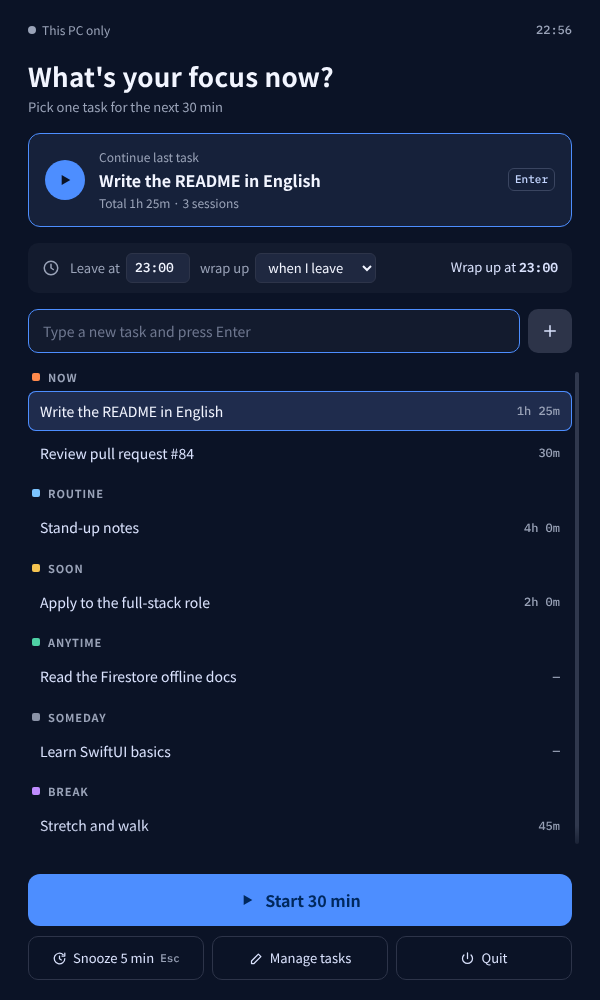
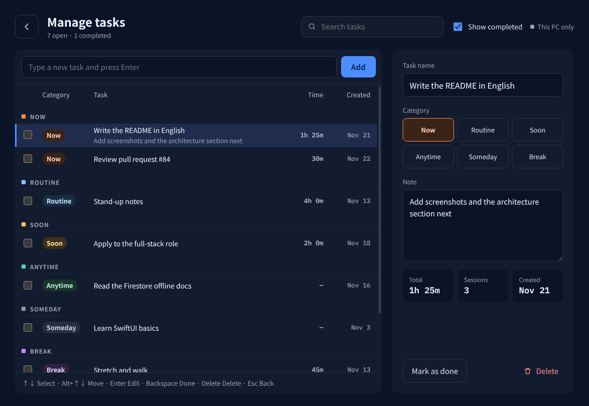
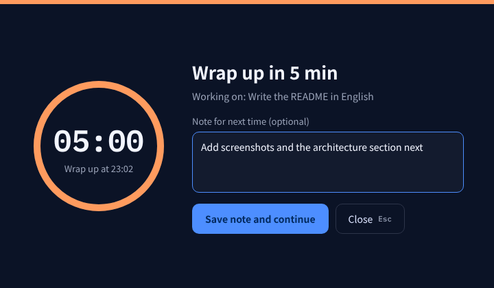
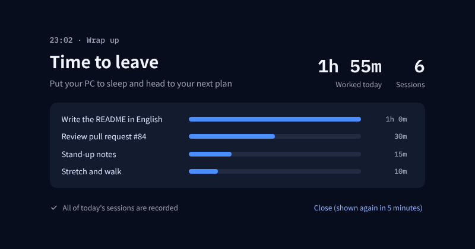

# Shiodoki

[](https://github.com/kazi983/shiodoki/actions/workflows/lint.yml)
[](https://github.com/kazi983/shiodoki/actions/workflows/test.yml)
[](LICENSE)

[日本語](README.ja.md)

A desktop app that asks **"What's your focus now?"** every 30 minutes, records how long you spend on each task, and
stops your work shortly before you have to leave for your next plan. Tasks sync to an Android app through Firebase,
end-to-end encrypted.

The name is Japanese: _shiodoki_ (潮時) means "the right moment to switch".

<p>
  
  
</p>

## Features

- **30-minute focus loop** — a picker asks which task to work on next; a small overlay shows the remaining time.
- **Leave time** — set when you have to get up from the desk. Five minutes before, a warning lets you leave a note for
  next time; at the time, a full-screen block shows today's time per task.
- **Task management** — categories (Now, Routine, Soon, Anytime, Someday, Break), drag-and-drop ordering, notes,
  search, keyboard shortcuts and autosave.
- **Local or cloud** — use it on one PC with no network at all, or sign in with Google to sync with other PCs and the
  Android app. Works offline and syncs when the network comes back.
- **End-to-end encryption** — in cloud mode, task names and notes are encrypted on the device; the Firebase project
  owner cannot read them.
- **Android app** — manage tasks, see what the PC is doing, and pick a task each time you unlock the phone.
- **English and Japanese** UI.

<p>
  
  
</p>

## Tech stack

| Part    | Stack                                                                                       |
| ------- | ------------------------------------------------------------------------------------------- |
| Desktop | Electron, TypeScript, React, electron-vite, electron-builder (Windows installer and `.deb`) |
| Android | Kotlin, Jetpack Compose                                                                     |
| Backend | Firebase Authentication (Google), Cloud Firestore with security rules                       |
| Testing | Vitest, Playwright (Electron E2E), Firebase Emulator Suite, JUnit                           |
| Tooling | ESLint, Prettier, husky + lint-staged, GitHub Actions                                       |

## Architecture and key decisions

- **Testable core.** `appController.ts` runs the whole session flow (picker → running → interval → picker, snooze,
  leave warning and block) against small interfaces, so it is unit-tested with fake timers. Every delayed action goes
  through one `TimerService`, so all of it is cancellable.
- **Storage behind an interface.** `TaskRepository` has a JSON-file implementation for local mode and a Firestore one
  for cloud mode. The Firestore repository keeps an in-memory copy fed by snapshot listeners, so the UI never waits
  for the network, and writes send only the changed fields.
- **Offline first.** The Firebase SDK runs in a hidden window because Firestore's offline persistence needs IndexedDB;
  the main process talks to it through a bridge.
- **End-to-end encryption** ([design](docs/e2ee/design.md), in Japanese). AES-256-GCM with one data key per account,
  wrapped by a key from the passphrase (PBKDF2, 600,000 iterations) and by a recovery key. The same format works on
  Web Crypto and Android.
- **Security rules as the server-side contract.** Firestore rules accept only ciphertext for names and notes, require
  server timestamps, fixed categories, append-only sessions and soft delete. They are tested on the Firestore emulator.
- **Real-world edge cases.** Screen off, lock and suspend end the running session; leave times are rechecked by the
  wall clock after sleep; the app warns when the clock or time-zone data looks wrong.
- **No hard-coded UI text.** Tests fail if Japanese appears outside the translation files, on both desktop and Android.

## Repository layout

| Folder                            | Contents                                                     |
| --------------------------------- | ------------------------------------------------------------ |
| [`desktop/`](desktop/README.md)   | Desktop app (Electron + TypeScript + React; Ubuntu, Windows) |
| [`android/`](android/README.md)   | Android app (Kotlin + Jetpack Compose)                       |
| [`firebase/`](firebase/README.md) | Firestore security rules, emulator config and rules tests    |
| [`docs/`](docs/requirements.md)   | Requirements, designs and user guides                        |

Design documents are written in Japanese. The [user guide](docs/user-guide/README.md) is in English and Japanese.

## Install

Download the Windows installer or the Ubuntu `.deb` from
[GitHub Releases](https://github.com/kazi983/shiodoki/releases), then follow the
[user guide](docs/user-guide/en/desktop.md). Cloud sync is limited to accounts registered by the administrator while
the app is in a trial; local mode works for anyone.

## Development

```bash
npm install                      # formatter, linter and the pre-commit hook
cd desktop
npm install
npm run dev:local                # local mode, no Firebase needed
TASK_MODE=test npm run dev:local # 30 minutes become 5 seconds
```

Tests:

```bash
cd desktop
npm run typecheck && npm test    # unit tests
npm run test:integration         # Firestore repository on the emulator
npm run e2e:headless             # Playwright E2E (local and Firebase emulator)
cd ../firebase && npm test       # security rules on the emulator (Java 21+)
```

Cloud mode needs a Google OAuth client file; see [`desktop/README.md`](desktop/README.md). The Android build is
described in [`android/README.md`](android/README.md).

## Status

| Phase | Scope                                     | Status                                      |
| ----- | ----------------------------------------- | ------------------------------------------- |
| P0–P1 | Requirements, Firebase rules and emulator | Done                                        |
| P2–P3 | Desktop rebuild, Google sign-in, sync     | Done, in production use                     |
| P4    | Android: task management, PC status       | Done                                        |
| P5    | Android: focus screen on unlock           | Done (recovery and test-mode polish remain) |
| P6    | Reports, widgets                          | Not started                                 |

Shiodoki is v2 of [a Python/Tkinter app](https://github.com/kazi983/30min-task-timer-python), rebuilt for sync,
mobile access and a layout that works on Ubuntu.

## License

[MIT](LICENSE)
