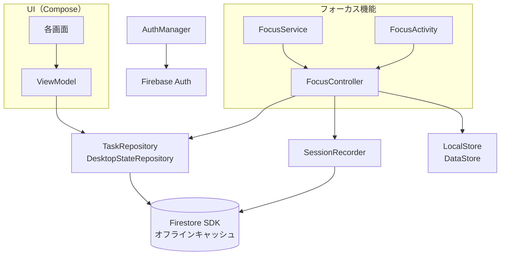
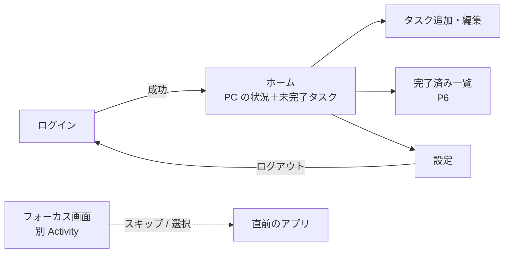
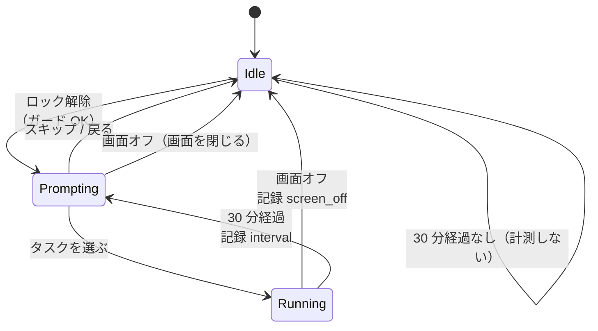
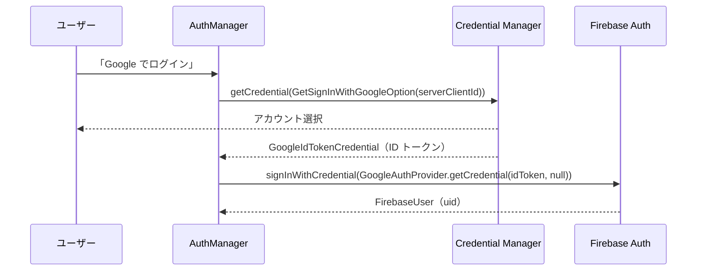

# Shiodoki Android アプリ 設計書

- ステータス: ドラフト v0.3（レビュー待ち）
- 作成日: 2026-10-06
- 対象フェーズ: P4（タスク管理・PC の状況表示）、P5（フォーカス画面）、P6 の一部
- 前提: [要件定義書](../requirements.md) v0.7。要件・データモデルは要件定義書が正で、本書は「どう作るか」を決める

## 変更履歴

| 版 | 日付 | 内容 |
|----|------|------|
| v0.1 | 2026-10-06 | 初版 |
| v0.2 | 2026-10-06 | パッケージ名を `dev.kaorukajihara.shiodoki` に決定（Q-A1）。SDK と Kotlin のバージョン、Emulator 接続時のログイン方法とローカルネットワーク権限を、実装（手順 1）に合わせて更新 |
| v0.3 | 2026-10-06 | 画面の見た目をデザインキャンバス「Shiodoki UI/UX改善案」（Android ページ）に合わせる（§5）。優先度の色と累計時間の表記をデスクトップと分ける（§4.1） |

---

## 1. 概要

### 1.1 本書の範囲

| 要件 | 内容 | フェーズ |
|------|------|---------|
| M-01〜M-05 | ログイン、未完了タスク一覧、追加・編集・完了・削除、PC の状況表示 | P4 |
| M-11〜M-16 | ロック解除時のフォーカス画面と、スマホのセッション記録 | P5 |
| M-17、M-18 | 強制終了時のセッション復旧、テストモード | P5 |
| M-06〜M-10 | 完了済み一覧、次タスク予約、集計、ウィジェット | P6（本書では方針のみ） |

### 1.2 設計方針

1. **デスクトップと同じ考え方にそろえる**。データの書き方（変更フィールドだけ送る、`increment()`、`serverTimestamp()`、書き込みを待たない）、セッションの終わらせ方（終了処理は 1 か所・1 回だけ）は `desktop/` の実装に合わせる。
2. **Firestore のオフライン機能に任せる**。独自の DB（Room）や送信キューは作らない（要件 §5.3）。
3. **ロジックを Android のクラスから切り離してテストする**。フォーカス画面の状態遷移は、時計とリポジトリを差し替えられる純粋な Kotlin クラスにし、JVM のユニットテストで確かめる（デスクトップの `AppController` と同じ方針）。
4. **小さく作る**（KISS / YAGNI）。DI ライブラリ（Hilt）やマルチモジュールは使わず、1 モジュール＋手書きの依存コンテナにする。

---

## 2. 技術スタック

| 項目 | 採用 | 理由・補足 |
|------|------|-----------|
| 言語 | Kotlin | 要件 §6.4 |
| UI | Jetpack Compose ＋ Material 3 | 要件 §6.4 |
| 画面遷移 | Navigation Compose | 画面数が少ないので型安全ルート（`@Serializable` なルート）で十分 |
| 非同期 | Kotlin Coroutines / Flow | Firestore のスナップショットを `callbackFlow` で `Flow` にする |
| 状態保持 | `ViewModel` ＋ `StateFlow` | 画面回転などで状態を失わない |
| Firebase | Firebase BoM（Auth、Firestore） | オフライン永続化は Android SDK で標準有効 |
| ログイン | Credential Manager ＋ `googleid`（Sign in with Google） | 要件 §6.4。旧 `GoogleSignInClient` は非推奨なので使わない |
| 端末内の小さな設定 | Jetpack DataStore（Preferences） | フォーカス機能のオン/オフ、スマホの前回選択、実行中セッション（§6.6） |
| DI | 手書きの `AppContainer`（`Application` が保持） | 依存は 10 個程度。Hilt の学習・ビルドコストに見合わない |
| テスト | JUnit 4、kotlinx-coroutines-test、Turbine（Flow のテスト） | §10 |
| 最小 / ターゲット SDK | `minSdk = 29`（Android 10）、`compileSdk` / `targetSdk` = 37 | 要件 N-07。最新の AndroidX が `compileSdk` 37 以上を要求する |
| ビルド | AGP 9.4.1（組み込みの Kotlin）、Gradle 9.6.0、Kotlin 2.4.20 | AGP 9.4.1 が持つ Kotlin 2.2 は、Kotlin 2.4 でビルドされたライブラリ（`googleid` 1.2.1 など）を読めない。ルートの `build.gradle.kts` で `org.jetbrains.kotlin.android` を宣言して新しい KGP を使わせる |

---

## 3. プロジェクト構成

### 3.1 ディレクトリ

```
android/
├─ app/
│  ├─ build.gradle.kts
│  ├─ google-services.json        Firebase の Android アプリ設定（公開情報。§9.2）
│  └─ src/
│     ├─ main/
│     │  ├─ AndroidManifest.xml
│     │  └─ java/dev/kaorukajihara/shiodoki/
│     │     ├─ ShiodokiApp.kt            Application。AppContainer を作る
│     │     ├─ AppContainer.kt           依存の組み立て（手書き DI）
│     │     ├─ model/                    Task, Priority, Session, DesktopState など
│     │     ├─ data/
│     │     │  ├─ TaskRepository.kt      インターフェース
│     │     │  ├─ FirestoreTaskRepository.kt
│     │     │  ├─ DesktopStateRepository.kt
│     │     │  ├─ SessionRecorder.kt     sessions 追加＋increment のバッチ
│     │     │  ├─ Mapping.kt             Firestore ドキュメント ⇔ モデル
│     │     │  └─ LocalStore.kt          DataStore のラッパー
│     │     ├─ auth/AuthManager.kt       Credential Manager → Firebase Auth
│     │     ├─ focus/
│     │     │  ├─ FocusController.kt     状態遷移（Android 非依存・テスト対象）
│     │     │  ├─ FocusService.kt        フォアグラウンドサービス
│     │     │  ├─ FocusActivity.kt       フォーカス画面
│     │     │  ├─ DeviceGuards.kt        通話中・アラーム中の判定
│     │     │  └─ BootReceiver.kt
│     │     └─ ui/
│     │        ├─ login/  home/  edit/  completed/  settings/  focus/
│     │        ├─ components/            TaskRow、PriorityChip、PcStatusCard など
│     │        └─ theme/
│     ├─ test/                           JVM ユニットテスト
│     └─ androidTest/                    Emulator を使う結合テスト（任意、§10）
├─ build.gradle.kts
├─ settings.gradle.kts
└─ gradle/libs.versions.toml            バージョンカタログ
```

パッケージ名（`applicationId`）は `dev.kaorukajihara.shiodoki`（§12 の Q-A1）。Firebase に登録すると変えにくい。

### 3.2 レイヤー構成



- 画面と `FocusController` は **インターフェース（`TaskRepository` など）にだけ依存** する。テストではフェイク実装に差し替える。
- Firestore を触るのは `data/` だけ（要件 N-10）。
- `TaskRepository` のスナップショット購読は **アプリのプロセスで 1 つだけ** 持ち、`StateFlow<List<Task>>` として画面とフォーカス画面で共有する。フォーカス画面を開いた時点で一覧がメモリにあるので、1 秒以内に表示できる（要件 N-06）。

---

## 4. データアクセス設計

データモデルは要件 §5.1、検証は `firebase/firestore.rules` が正。ここでは Android からの読み書きの仕方だけを決める。

### 4.1 モデル

```kotlin
enum class Priority(val label: String) {  // declaration order = sort order
  NOW("今すぐ"),
  SOONER("近いうち"),
  ANYTIME("いつでも"),
  SOMEDAY("いつか"),
}

data class Task(
  val id: String,
  val name: String,
  val memo: String,
  val priority: Priority,
  val completed: Boolean,
  val completedAt: Instant?,
  val deleted: Boolean,
  val totalMinutes: Long,
  val sessionCount: Long,
  val createdAt: Instant,
  val updatedAt: Instant,
)
```

- 表示ラベルはデスクトップの `PRIORITY_META`（`desktop/src/shared/task.ts`）と同じ。色はダークテーマ用にデザインキャンバスの値を使い、UI 層（`ui/theme`）に置く（NOW `#ff8a4c`、SOONER `#f5c451`、ANYTIME `#4fd1a5`、SOMEDAY `#8b93a7`）。
- 並び順もデスクトップの `compareTasks` と同じ「優先度の並び順 → 作成日時の古い順」。
- 入力チェックもデスクトップの `normalizeTaskInput` と同じ（前後の空白を除く、名前必須・200 文字以内、メモ 5000 文字以内）。エラーメッセージも同じ文言にする。
- 時刻は `java.time.Instant` で持ち、表示時に端末のタイムゾーンへ変換する（要件 N-09）。

### 4.2 読み込み

| 対象 | 方法 |
|------|------|
| `tasks` | コレクション全体を `addSnapshotListener` で購読し、`deleted == false` はアプリ側で絞り込む。タスク数は数百件の想定で、クエリにするとインデックスやキャッシュの扱いが増えるだけなので全件購読でよい |
| `state/desktop` | ドキュメントを購読（PC の状況カード、フォーカス画面の「PC で実行中」） |
| `state/preferences` | ドキュメントを購読（M-08 の次タスク予約を表示するため。P6） |
| `sessions` | P4・P5 では読まない。M-09（集計）で期間を指定したクエリを使う |

- `serverTimestamp()` が未確定（オフライン中に書いた直後など）のフィールドは `ServerTimestampBehavior.ESTIMATE` で読み、null にならないようにする（デスクトップの `serverTimestamps: "estimate"` と同じ）。
- 型が想定外の値は既定値に置き換える（優先度が不明なら `SOMEDAY` など。デスクトップの `docToTask` と同じ）。
- ログアウト時・ユーザー切り替え時は購読を解除する。

### 4.3 書き込み

ルールに合わせ、すべての書き込みで次を守る。

- `updatedAt` は **必ず `FieldValue.serverTimestamp()`**（ルールが `updatedAt == request.time` を要求する）。
- `updatedBy` は `"android"`。
- 書き込みの `Task` は **待たない**。`await()` すると、オフライン時にサーバーの応答が来るまで止まってしまう。端末内キャッシュへの反映は即時で、スナップショット購読から画面に反映される。失敗（ルール違反など）は `addOnFailureListener` でログに出し、画面にはスナックバーで知らせる。

| 操作 | 書き込み内容 |
|------|-------------|
| 追加（M-03、クイック追加） | `tasks/{UUID}` に全フィールドを `set()`。`completed=false`、`completedAt=null`、`deleted=false`、`totalMinutes=0`、`sessionCount=0`、`createdAt=Timestamp.now()`。ID はクライアントで `UUID.randomUUID()` を作る（再送しても重複しない） |
| 編集（M-04） | 変更したフィールドだけ `update()`（`name` / `memo` / `priority`）＋ `updatedAt` / `updatedBy` |
| 完了 / 未完了に戻す | `completed`、`completedAt`（完了時は `Timestamp.now()`、戻すときは `null`）を `update()` |
| 削除 | `deleted=true` を `update()`（論理削除。物理削除はルールで拒否される） |
| セッション記録 | §4.4 |
| 次タスク予約（M-08、P6） | `state/preferences` に `nextTaskId` と `updatedAt` を `set(..., SetOptions.merge())` |

- `createdAt` は更新時に送らない（ルールで変更が禁止されている）。
- `totalMinutes` / `sessionCount` は `increment()` 以外で書かない（要件 §5.3）。

### 4.4 セッションの記録（`SessionRecorder`）

スマホのセッションは、デスクトップと同じく **1 回のバッチ書き込み** で記録する（要件 §5.2）。

```kotlin
fun record(s: FinishedSession) {
  val batch = db.batch()
  batch.set(sessionsRef.document(s.id), mapOf(
    "taskId" to s.taskId,
    "taskName" to s.taskName.take(200),
    "startedAt" to Timestamp(s.startedAt),
    "endedAt" to Timestamp(s.endedAt),
    "elapsedMinutes" to s.elapsedMinutes,
    "endReason" to s.endReason.value,   // "screen_off" / "interval" / "app_exit"
    "device" to Build.MODEL.take(100),
  ))
  batch.update(tasksRef.document(s.taskId), mapOf(
    "totalMinutes" to FieldValue.increment(s.elapsedMinutes),
    "sessionCount" to FieldValue.increment(1),
    "updatedAt" to FieldValue.serverTimestamp(),
    "updatedBy" to "android",
  ))
  batch.commit()  // not awaited
}
```

- 経過分数はデスクトップの `elapsedMinutes` と同じく **切り捨て**。**0 分（1 分未満）のときは記録しない**（M-13）。
- セッション ID は開始時に `UUID` で作り、§6.6 の保存データにも持たせる。強制終了からの復旧で 2 回記録しようとしても同じ ID なので、sessions は重複しない。
  - ただし `increment()` は 2 回送れば 2 回加算される。これを防ぐため、**記録したら即座に保存データを消す** 順序を守る（§6.6）。
- 記録中にタスクが削除・完了されていても記録する（作業した事実は残す）。タスクのドキュメント自体がない場合（あり得ないが）は `update()` が失敗してバッチ全体が失敗するので、ログに残す。

---

## 5. 画面設計

### 5.1 画面一覧と遷移



- `MainActivity` 1 つの中で Navigation Compose を使う。起動時、ログイン済みならホーム、未ログインならログイン画面。
- フォーカス画面だけは **別の Activity（`FocusActivity`）** にする。サービスから起動し、閉じたら直前に使っていたアプリに戻すため（§6.4）。

- **見た目はデザインキャンバス「Shiodoki UI/UX改善案」の Android ページが正**（https://claude.ai/artifact/NS8tDGjQPPkN9YXTFBDQso）。紺色の固定ダークテーマ（システムのテーマや壁紙の色には従わない）、本文は Noto Sans JP、数値は IBM Plex Mono（どちらも Google Fonts のダウンロード可能フォント。Play 開発者サービスがなければ端末の標準フォント）。
- 下部のタブは「タスク」「設定」。「完了済み」「集計」は P6 で足す。設定はタブなので、戻るボタンではホーム（タスク）に戻る。
- キャンバスにあるが未実装の要素（PC の状況カード、「PC で次にやる」、設定のフォーカス・権限・テストモード）は、その機能を作る手順で足す。

### 5.2 ログイン画面（M-01）

- 「Google でログイン」ボタンだけ。処理の流れは §7。
- 失敗時はエラー文を表示（キャンセルは何も出さない）。

### 5.3 ホーム画面（M-02、M-05）

```
┌──────────────────────────────┐
│ タスク                ● 同期済み │
├──────────────────────────────┤
│ 💻 PC: 実行中（手順 4）        │
│   資料作成                    │
│   14:05 開始・32 分経過       │
├──────────────────────────────┤
│ ■ NOW  今すぐ                 │
│  バグ修正               2h 05m │
│  フッターの金額欄…（メモ 1 行目）│
│  資料作成                  45m │
│ ■ SOONER  近いうち            │
│  読書                       — │
│ ...                     [＋] │
├──────────────────────────────┤
│   [タスク]         設定        │
└──────────────────────────────┘
```

- **PC の状況カード**：`state/desktop` から次の順で判定する（`PcStatus` を返す純粋関数にしてテストする）。

  | 条件（上から順に判定） | 表示 |
  |------|------|
  | ドキュメントがない | 「PC の情報がありません」 |
  | `status == stopped` | 「PC のアプリは終了しています」 |
  | `heartbeatAt` が **10 分より古い** | 「PC オフライン（最終確認 HH:mm）」 |
  | `running` | 実行中タスク名・開始時刻・経過時間（1 分ごとに更新） |
  | `snoozed` | 「スヌーズ中（HH:mm に再表示）」（`nextPromptAt`） |
  | `idle` | 「タスク選択中」 |
  | `leave_blocked` | 「停止中」 |

  - heartbeat はデスクトップで 5 分間隔（`HEARTBEAT_MS`）。通信の遅れを見込んで 2 回分（10 分）を「オフライン」の境目にする。
  - 「古い」の判定は端末の時計で行う。1 分ごとに再判定する（ドキュメントが更新されなくても表示が変わるため）。
- **タスク一覧**：未完了かつ未削除、§4.1 の順で、優先度ごとの見出しの下にまとめる（タスクのない優先度は見出しも出さない）。各行に名前・メモの 1 行目・累計時間。累計時間はデザインに合わせて「2h 05m」「45m」「—」（0 分）と表記する（デスクトップは「2時間5分」）。
  - 行をタップ → 編集画面。
  - 行を長押し → 「完了」（確認ダイアログあり、M-04）。右スワイプは作らない。
- **同期状態**（要件 D-06 の Android 版。Should）：スナップショットの `metadata.hasPendingWrites` と `isFromCache` から「同期済み / 未送信あり / オフライン」を、色つきの点と一緒に見出しの右に出す。
- **＋ボタン** → 追加画面。

### 5.4 タスク追加・編集画面（M-03、M-04）

- 項目：名前（必須）、優先度（4 つ並んだボタンから選ぶ。新規の初期値は `NOW`）、メモ（複数行）。編集時は累計時間・セッション数・作成日（MM-dd）も出す。
- 下部に大きな保存ボタン（新規は「追加」、編集は「変更を保存」）。キャンバスの「PC で次にやる」スイッチは M-08（P6）で足す。
- 編集時のみ「完了」「削除」ボタン。どちらも確認ダイアログを出す（要件 F-14）。
- 保存は書き込みを待たずにすぐ前の画面に戻る（§4.3）。
- 編集中に他端末でそのタスクが変更された場合：入力中の内容を優先し、保存時に **変更したフィールドだけ** 送る（要件 §5.3 の 2）。入力欄を勝手に書き換えない。

### 5.5 完了済み一覧（M-06、P6）

- 完了済みかつ未削除を `completedAt` の新しい順。「未完了に戻す」（確認あり）。

### 5.6 設定画面（M-16、A-04）

| 項目 | 内容 |
|------|------|
| フォーカス画面 | オン/オフのスイッチ。オンにするとき、足りない権限を順に案内する（§6.7） |
| 権限の状態 | 3 つの権限それぞれの「許可済み / 未許可」と、未許可なら設定画面を開くボタン |
| テストモード | debug ビルドのときだけ表示（M-18、§6.8） |
| ログイン中のアカウント | メールアドレス表示 |
| ログアウト | 確認ダイアログ → §7.2 |

### 5.7 フォーカス画面（M-11〜M-14）

```
┌──────────────────────────────┐
│     今から何をやる？          │
│                              │
│ 💻 PC と同じ：資料作成   [選ぶ] │  ← PC が running のときだけ
│ 📱 前回：英単語          [選ぶ] │  ← スマホの前回選択があり、未完了のときだけ
├──────────────────────────────┤
│ 🔥 バグ修正                    │
│ 🔥 資料作成                    │
│ ⭐ 読書                        │
│ ...（スクロール）              │
├──────────────────────────────┤
│ [新しいタスク名______] [追加]   │  ← クイック追加（優先度 NOW）
│                              │
│           スキップ             │
└──────────────────────────────┘
```

- 全画面・ダークでも読める配色。ステータスバーは表示したまま（時刻や通知を見られるように）。
- 「PC と同じ」は `state/desktop` が `running` で、かつ heartbeat が新しい（§5.3 と同じ判定）ときだけ出す。
- クイック追加は、タスクを追加して一覧の先頭付近（`NOW` の末尾）に強調表示するだけで、セッションは開始しない。開始はそのタスクをタップする（デスクトップのクイック追加も「追加して選択状態にする」だけで、開始は別操作。Q-A3）。
- タスク一覧はホームと同じ `StateFlow` を使うので、開いた瞬間に表示される。
- 「スキップ」と戻るボタンは同じ動き（M-14）。

---

## 6. フォーカス機能の設計（P5）

### 6.1 部品

| 部品 | 役割 |
|------|------|
| `FocusService` | フォアグラウンドサービス。`ACTION_USER_PRESENT`（ロック解除）と `ACTION_SCREEN_OFF` を **動的に登録した BroadcastReceiver** で受け、`FocusController` に渡す。この 2 つはマニフェストに書いても届かない（要件 §6.4） |
| `FocusController` | 状態遷移と時間計測。Android のクラスに依存しない（時計、リポジトリ、`SessionRecorder`、`LocalStore`、画面を出す処理をコンストラクタで受け取る） |
| `FocusActivity` | フォーカス画面。選択・スキップ・クイック追加を `FocusController` に伝えて閉じる |
| `DeviceGuards` | 通話中・着信中・アラーム鳴動中かどうか（M-15） |
| `BootReceiver` | `BOOT_COMPLETED` / `MY_PACKAGE_REPLACED` でサービスを起動（機能がオンでログイン済みのときだけ） |

`FocusController` は `AppContainer` が 1 つだけ作り、サービスと Activity から共有する（同じプロセス内）。

### 6.2 状態遷移



| 状態 | 意味 |
|------|------|
| `Idle` | 何もしていない（スキップ後、画面オフ後、通話中で出さなかったとき） |
| `Prompting` | フォーカス画面を表示中 |
| `Running(sessionId, taskId, taskName, startedAt)` | スマホのセッション中。30 分タイマーが動いている |

イベントごとの処理：

| イベント | 条件 | 処理 |
|---------|------|------|
| ロック解除 | 機能オン・ログイン済み・`DeviceGuards` が OK・`Idle` | `Prompting` にして `FocusActivity` を起動 |
| ロック解除 | 上記以外 | 何もしない |
| タスク選択 | `Prompting` | 新しい `sessionId` で `Running` にし、30 分タイマーを開始。§6.6 の保存データを書く。スマホの前回選択を DataStore に保存（`state/preferences` は更新しない） |
| スキップ / 戻る | `Prompting` | `Idle`。記録しない |
| 30 分経過 | `Running` | `finishSession(interval)` → `Prompting` にして `FocusActivity` を起動 |
| 画面オフ | `Running` | `finishSession(screen_off)` → `Idle` |
| 画面オフ | `Prompting` | `FocusActivity` を閉じて `Idle`（次のロック解除でまた出る） |
| サービス開始 | 保存データあり | `finishSession(app_exit, endedAt = lastSeenAt)`（§6.6） |
| ログアウト / 機能オフ | `Running` | `finishSession(app_exit)` → `Idle` |

- **セッションを終える処理は `finishSession(reason, endedAt)` の 1 か所だけ** にする。中で「状態を `Idle` に戻す → 保存データを消す → 1 分以上なら `SessionRecorder.record()`」を行い、2 回呼ばれても 2 回目は何もしない（デスクトップの `SessionService.finish()` と同じ考え方）。
- 30 分タイマーはサービスの `CoroutineScope` で `delay()` する。セッションは画面オフで終わるので、Doze 中に動かす必要はなく、`AlarmManager` は使わない（要件 §6.4）。
- スキップ後、画面をつけたまま 30 分経っても再表示しない（要件に記載がないため。Q-A2）。

### 6.3 通話・アラームの判定（M-15）

追加の権限が要らない `AudioManager` だけで判定する。

| 状況 | 判定 |
|------|------|
| 通話中・VoIP 通話中・着信中 | `audioManager.mode` が `MODE_IN_CALL` / `MODE_IN_COMMUNICATION` / `MODE_RINGTONE` |
| アラーム鳴動中 | `audioManager.activePlaybackConfigurations` に `usage == USAGE_ALARM` のものがある |

- 通話中にロック解除しても何もしない（通話後、次のロック解除で出る）。
- `Running` 中に電話がかかってきた場合はセッションを続ける（画面オフで自然に終わる）。

### 6.4 フォーカス画面の起動

- サービスから `startActivity(Intent(FocusActivity, FLAG_ACTIVITY_NEW_TASK))` で起動する。
- バックグラウンドからの Activity 起動は Android 10 以降制限されているが、**「他のアプリの上に重ねて表示」（`SYSTEM_ALERT_WINDOW`）が許可されていれば例外** になる（要件 §6.4）。起動前に `Settings.canDrawOverlays()` を確認し、未許可なら起動せず、常駐通知の文言で権限不足を知らせる。
- マニフェストの指定：

  ```xml
  <activity
      android:name=".focus.FocusActivity"
      android:excludeFromRecents="true"
      android:taskAffinity=".focus"
      android:launchMode="singleInstance"
      android:showWhenLocked="false"
      android:theme="@style/Theme.Focus" />
  ```

  - `excludeFromRecents` で「最近使ったアプリ」に残さない。
  - 別の `taskAffinity` ＋ `singleInstance` で、本体（`MainActivity`）のタスクと混ざらず、閉じると直前のアプリに戻る。
  - `showWhenLocked="false"` でロック画面の上には出さない（M-11）。
- 閉じるときは `finishAndRemoveTask()`。

### 6.5 フォアグラウンドサービス

- 種類は `specialUse`（Android 14 以上で必須の宣言）。マニフェストに用途の説明（`PROPERTY_SPECIAL_USE_FGS_SUBTYPE`）を書く。ストア公開しないので審査は関係ないが、宣言しないと起動時に例外になる。
- 常駐通知（優先度低、通知チャンネルは「フォーカス画面の待機」）に、状態（「待機中」「英単語 実行中（14:05〜）」「権限が不足しています」）を出す。通知タップでホーム画面を開く。
- `onStartCommand` は `START_STICKY`。OS に止められても再起動され、そのとき §6.6 の復旧を行う。
- **起動のタイミング**：設定画面で機能をオンにしたとき（アプリが前面にいるので制限なし）、`BOOT_COMPLETED`、アプリ起動時（機能オンなのにサービスがいなければ起動）。
  - Android 15 以降は「`SYSTEM_ALERT_WINDOW` を持っているだけ」ではバックグラウンドからのフォアグラウンドサービス起動の例外にならなくなった（オーバーレイのウィンドウが見えている必要がある）。本設計では上記のタイミングでしか起動しない（`BOOT_COMPLETED` は別の例外に当たる）ので影響はないが、**バックグラウンドからサービスを起動する処理を追加しない** こと。
  - `BOOT_COMPLETED` から起動できないフォアグラウンドサービスの種類が Android 15 で追加されたが、`specialUse` は対象外。実機で確認する（§11）。

### 6.6 実行中セッションの保存と復旧（M-17）

プロセスが OS に強制終了されると、メモリ上の `Running` 状態は消える。そこで DataStore に次を保存する。

| キー | 内容 |
|------|------|
| `runningSessionId` | セッション ID |
| `runningTaskId` / `runningTaskName` | 対象タスク |
| `runningStartedAt` | 開始時刻 |
| `runningLastSeenAt` | 最後に「画面がついていて動いていた」と確認した時刻 |

- `Running` の間、**1 分ごとに `runningLastSeenAt` を更新** する。
- サービス開始時に保存データがあれば、`endedAt = runningLastSeenAt` で `app_exit` として記録し、保存データを消す。強制終了から再起動までの時間（画面オフ中かもしれない）は数えない。
- 記録の順序は「保存データを消す → `SessionRecorder.record()`」。逆にすると、記録の直後に強制終了されたとき、次の起動でもう一度 `increment()` されてしまう。消した直後に強制終了された場合はその 1 回分が記録されないが、二重計上よりは害が小さいと判断する。

### 6.7 権限（M-16）

| 権限 | 用途 | 取得方法 |
|------|------|---------|
| `SYSTEM_ALERT_WINDOW` | バックグラウンドからフォーカス画面を出す | `Settings.ACTION_MANAGE_OVERLAY_PERMISSION` を開いて許可してもらう |
| `POST_NOTIFICATIONS`（Android 13 以上） | 常駐通知を見せる。拒否されてもサービスは動くが、通知が出ない | 実行時の権限リクエスト |
| 電池の最適化の対象外 | メーカー独自の省電力でサービスが止められるのを防ぐ | `Settings.ACTION_REQUEST_IGNORE_BATTERY_OPTIMIZATIONS`（`REQUEST_IGNORE_BATTERY_OPTIMIZATIONS` 権限を宣言） |
| `FOREGROUND_SERVICE`、`FOREGROUND_SERVICE_SPECIAL_USE`、`RECEIVE_BOOT_COMPLETED` | サービスと再起動時の起動 | マニフェストに書くだけ（ユーザー操作不要） |

- 機能をオンにしたとき、上の表の順に 1 つずつ案内する（説明文 → 「設定を開く」）。設定から戻ってきたら（`onResume`）状態を確認し直す。
- 3 つそろわなくてもオンにはできるが、設定画面に「未許可」を表示し続ける。

### 6.8 テストモード（M-18）

- debug ビルドだけ、設定画面に「テストモード」スイッチを出す。
- オンのとき、30 分 → **30 秒**、「1 分未満は記録しない」→「**5 秒未満**は記録しない」にする（経過分数は 0 分になるが、記録の流れを確かめるため）。デスクトップの `TASK_MODE=test` に相当。
- 時間の値は `FocusConfig`（`intervalMs`、`minRecordMs`）として `FocusController` に渡し、ユニットテストでも使う。
- 1 分未満の記録はルール上 `elapsedMinutes = 0` で問題ないが、本番データを汚さないよう、テストモードは Emulator 接続（§9.3）と組み合わせて使う。

---

## 7. 認証設計

### 7.1 ログイン（M-01、A-02）



- `serverClientId` は Firebase が作った **Web クライアント ID**（`google-services.json` から生成される `R.string.default_web_client_id`）。Android 用クライアント ID ではない点に注意。
- ログイン状態は Firebase Auth が端末に保存するので、2 回目以降・オフライン起動時もログイン済みとして動く（A-02）。`FirebaseAuth.currentUser` があればホームへ。
- デスクトップと同じ Google アカウントでログインすれば同じ `uid` になり、同じデータを見る。

### 7.2 ログアウト（A-04）

1. 確認ダイアログ。
2. フォーカス機能が `Running` なら `finishSession(app_exit)` で記録する。
3. `FocusService` を止める。
4. スナップショット購読を解除する。
5. `FirebaseAuth.signOut()`、`CredentialManager.clearCredentialState()`（次回にアカウント選択を出すため）。
6. スマホの前回選択など、DataStore のユーザー依存データを消す。
7. ログイン画面へ。

- Firestore のオフラインキャッシュは消さない（同じアカウントで再ログインすれば速く表示できる。別アカウントのデータは `users/{uid}` が違うので見えない）。

---

## 8. エラー処理・エッジケース

| 状況 | 動き |
|------|------|
| オフラインでタスク追加 | キャッシュに即反映、オンライン復帰時に送信（M-07） |
| ルール違反で書き込みが拒否された | 端末内の変更は SDK が元に戻す。スナックバーで「保存できませんでした」。ログに詳細 |
| フォーカス画面表示中にタスクが他端末で削除・完了された | 一覧から消える（購読で反映）。選んだ直後に消えた場合でもセッションは記録する（§4.4） |
| 実行中のタスクがホームで完了にされた | セッションは続ける（画面オフ・30 分で記録）。デスクトップのような「完了したらセッション終了」はしない（スマホではホームを開いている間もセッション中のため、Q-A4） |
| 端末の時計がずれている | `startedAt` / `endedAt` は端末時刻で記録される（デスクトップも同じ）。ルールは `endedAt >= startedAt` だけを検証する |
| 機能オンだがログアウト状態（トークン失効など） | サービスは何もせず、常駐通知に「ログインしてください」 |
| 画面がついたまま端末を放置 | 30 分ごとに `interval` で記録され、フォーカス画面が出る（画面は通常すぐ消灯するので実害は小さい） |

---

## 9. ビルド・設定

### 9.1 Firebase への登録（P4 着手時、手作業）

1. Firebase コンソール → プロジェクト `shiodoki-e4e8f` → Android アプリを追加（パッケージ名 `dev.kaorukajihara.shiodoki`）。
2. **debug 用と release 用、両方の署名証明書の SHA-1** を登録する（Google ログインに必須）。debug 用は `./gradlew signingReport` で確認できる。
3. `google-services.json` をダウンロードして `android/app/` に置く。
4. この手順は `android/README.md` に書く（`firebase/README.md` の「Android アプリの登録」から参照する）。

### 9.2 秘密情報の扱い

| ファイル | コミット | 理由 |
|---------|---------|------|
| `google-services.json` | する | デスクトップの `firebaseConfig.ts` と同じく、アプリに埋め込む前提の公開情報。データはルールで守る |
| release 用の keystore（`.jks`）、`keystore.properties` | **しない**（`.gitignore`） | 署名鍵。漏れると他人が同じ署名のアプリを作れる |

### 9.3 Emulator 接続

- debug ビルドで `BuildConfig.USE_FIREBASE_EMULATOR`（`local.properties` の `shiodoki.useFirebaseEmulator=true` で切り替え）が true のとき、`useEmulator("10.0.2.2", 8080)`（Firestore）と `useEmulator("10.0.2.2", 9099)`（Auth）を呼ぶ。`10.0.2.2` は Android Emulator からホスト PC を指すアドレス。
- Emulator の Auth は Google ログインを本物では行わないので、Emulator 接続時は Credential Manager を使わず、署名のない偽の Google ID トークン（`{"sub":"e2e-user","email":"e2e@example.com",...}`）で `signInWithCredential` する。デスクトップの `TIMER_FIREBASE_EMULATOR=1` と同じ偽アカウントなので、同じ Emulator プロジェクトなら同じユーザーになる。
- Emulator は平文の HTTP なので、debug ビルドだけ `network_security_config` で `10.0.2.2` への平文通信を許可する。
- Android 17（API 37）以降、`10.0.2.2` のようなローカルネットワークのアドレスへの接続には `ACCESS_LOCAL_NETWORK`（実行時権限）が要る。debug のマニフェストにだけ宣言し、許可は `adb install -g` で与える（画面での権限リクエストは作らない）。

### 9.4 配布

- 署名付き release APK を作り、自分の端末に直接インストールする（要件 §6.4）。バージョンは `versionName` を `MAJOR.MINOR.PATCH`、`versionCode` を連番で上げ、Git タグ `android-vX.Y.Z` を打つ。

---

## 10. テスト方針

| 種類 | 対象 | 方法 |
|------|------|------|
| ユニット（JVM） | `FocusController` の状態遷移（§6.2 の表すべて、二重終了しないこと、1 分未満を記録しないこと、復旧時の `app_exit`） | フェイクの時計・リポジトリ・`SessionRecorder`・`LocalStore`、`runTest` の仮想時間で 30 分を進める |
| ユニット（JVM） | `PcStatus` の判定（§5.3 の表、境界の 10 分） | 純粋関数のテスト |
| ユニット（JVM） | 並び順、入力チェック、`Mapping`（型が想定外の値の扱い） | デスクトップの `task.test.ts` と同じケースを移植 |
| ユニット（JVM） | ViewModel（追加・編集・完了で正しいパッチを送るか） | フェイク `TaskRepository` |
| 結合（任意） | `FirestoreTaskRepository` / `SessionRecorder` がルールを通るか | Android Emulator ＋ Firebase Emulator。CI ではなく手元で実行 |
| 手動（実機） | §11 のチェックリスト | 実機で確認し、結果を実装ログに残す |

- Firestore ルール自体のテストは既存の `firebase/` のテストで行う。Android 側の書き込み形式が変わる場合は、ルールのテストにも同じ形のケースを足す。

---

## 11. 実機確認チェックリスト（P5 完了条件）

- [ ] ロック解除でフォーカス画面が出る。ロック画面の上には出ない
- [ ] タスクを選ぶと直前のアプリに戻り、常駐通知に実行中タスクが出る
- [ ] 1 分以上使って画面オフ → `sessions` に `screen_off` が 1 件、タスクの累計時間が増え、PC のタスク管理画面に反映される
- [ ] 1 分未満で画面オフ → 記録されない
- [ ] 画面をつけたまま 30 分（テストモードでは 30 秒）→ `interval` で記録され、フォーカス画面が再表示される
- [ ] スキップ・戻るボタン → 記録されない、直前のアプリに戻る
- [ ] 通話中・着信中・アラーム鳴動中のロック解除では出ない
- [ ] 実行中にアプリを強制停止（`adb shell am kill`）→ 次回起動で `app_exit` が 1 件だけ記録される
- [ ] 端末を再起動 → サービスが自動で起動する
- [ ] 機能オフ → ロック解除しても出ない、常駐通知が消える
- [ ] 機内モードで操作 → オンライン復帰後に記録が届く
- [ ] 「最近使ったアプリ」にフォーカス画面が残らない
- [ ] 手元の端末のメーカー独自の省電力機能でサービスが止まらない（数日使って確認）

---

## 12. 未決事項（レビューで決めたい点）

| # | 内容 | 本書の仮決め |
|---|------|-------------|
| Q-A1 | パッケージ名（`applicationId`） | **決定**：`dev.kaorukajihara.shiodoki`（所有ドメイン `kaorukajihara.dev` を逆にしたもの）。デスクトップの `appId` も別 PR でそろえる |
| Q-A2 | スキップ後、画面をつけたまま 30 分経ったらフォーカス画面を再表示するか | 再表示しない（次のロック解除まで出さない） |
| Q-A3 | フォーカス画面のクイック追加で、追加したタスクをそのまま開始するか | 開始しない（デスクトップと同じく追加と開始は別操作） |
| Q-A4 | スマホのセッション中に、そのタスクを完了にしたらセッションを終えるか | 終えない（画面オフ・30 分で記録） |
| Q-A5 | PC オフライン判定のしきい値 | heartbeat 2 回分（10 分） |
| Q-A6 | 「PC と同じ」を選んだとき、PC 側に何か伝えるか | 伝えない（要件 Q-10 と同じ） |

決まったら要件定義書（§3.4・§8）にも反映する。

---

## 13. 実装順序

| 順 | 内容 | 確認 |
|----|------|------|
| 1 | プロジェクト作成、Firebase 登録、ログイン・ログアウト | 実機で Google ログインでき、`uid` がデスクトップと一致する |
| 2 | モデル・`Mapping`・`TaskRepository`、ホーム（一覧のみ） | デスクトップで追加したタスクが数秒で出る |
| 3 | 追加・編集・完了・削除 | Android で追加したタスクが PC のタスク選択画面に出る（**P4 完了条件**） |
| 4 | PC の状況カード | PC でセッション開始・スヌーズ・終了したときに表示が変わる |
| 5 | `FocusController`（ユニットテスト込み） | テストが通る |
| 6 | `FocusService`・`FocusActivity`・権限の案内・設定画面 | §11 のチェックリスト（**P5 完了条件**） |
| 7 | 復旧（M-17）、テストモード（M-18） | §11 の強制停止の項目 |
| 8 | P6 の項目 | — |
