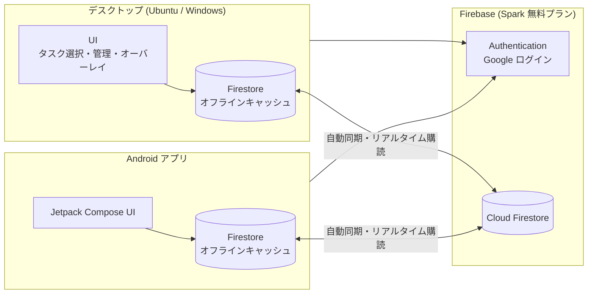

# Shiodoki 要件定義書

- ステータス: 確定 v0.28
- 更新日: 2026-10-29
- 対象: 現行アプリ v1（[kazi983/30min-task-timer-python](https://github.com/kazi983/30min-task-timer-python) の `main.pyw` / `app/`）の作り替え
- 本文中の `app/...` などのパスは v1 リポジトリのファイルを指す

## 変更履歴

| 版    | 日付       | 内容                                                                                                                                                                                                                                                                                                                      |
| ----- | ---------- | ------------------------------------------------------------------------------------------------------------------------------------------------------------------------------------------------------------------------------------------------------------------------------------------------------------------------- |
| v0.28 | 2026-10-29 | デスクトップで画面オフ（画面が暗くなる・ロック・スリープ）のときに実行中のセッションを記録し（`endReason: screen_off`）、画面がついたらタスク選択を出す。画面オフ中に作業ストップの時刻を過ぎていたらブロックせず選び直しにする（P-01〜P-04、§3.7、§5.1）                                                                 |
| v0.27 | 2026-10-29 | デスクトップの離席時刻の既定値をトレイで選べるようにし、空欄（離席スケジュールなし）と 0 分前を追加。入力欄の呼び方を「次の予定」から「離席時刻」に変更（§7.1）                                                                                                                                                           |
| v0.26 | 2026-10-25 | デスクトップの起動時に保存先（この PC だけ / Google でログインして同期）を選ぶ。同期する場合、タスク名・メモ・セッションのタスク名・PC の状況のタスク名をエンドツーエンド暗号化する（パスフレーズと回復キー、`state/keys`）。ルールは暗号文だけを受け付ける。設計は `docs/e2ee/design.md`（A-05、A-06、D-07、§5.1、§5.4） |
| v0.25 | 2026-10-22 | デスクトップ版を少人数の知人にも配る。各自が自分の Google アカウントで、自分のデータだけを使う（共有はしない）。無料枠の共有、プライバシーの説明、配布後のデータモデルの後方互換を決めた（§1.4、N-01、Q-13）                                                                                                              |
| v0.24 | 2026-10-22 | デスクトップ（Linux）の自動起動を追加。ログイン時と画面のロック解除時に、起動していなければ起動する。アプリの外（autostart と systemd の user service）で実現する（S-01、S-02、§3.6）                                                                                                                                     |
| v0.21 | 2026-10-21 | Android のフォーカス画面でタスクを選んだら、すぐ開始せず「『X』をはじめます」と確認し、「OK」で開始・「選び直す」で一覧に戻る（タップの誤りを防ぐため。M-13、§7.2、Q-11）                                                                                                                                                 |
| v0.20 | 2026-10-20 | 優先度を「分類」と呼び、`ROUTINE`（定期）と `BREAK`（休憩）を追加。並び順は `NOW` → `ROUTINE` → `SOONER` → `ANYTIME` → `SOMEDAY` → `BREAK`。動作は他の分類と同じ。フィールド名 `priority` と既存の値は変えない。§5.5 の絵文字を削除（UI では使っていない）（§5.1、§5.5）                                                  |
| v0.19 | 2026-10-18 | デスクトップのタスク選択・タスク管理・作業ストップの警告とブロックを、オーバーレイと同じく全ワークスペースに表示する（GNOME の「Always on Visible Workspace」と同じ動き。Ubuntu のみ）（§7.1）                                                                                                                            |
| v0.18 | 2026-10-18 | デスクトップのタスク管理画面を自動保存にする（入力が 1 秒止まったら保存。「変更を保存」ボタンと確認ダイアログは廃止）（§7.1）                                                                                                                                                                                             |
| v0.17 | 2026-10-18 | デスクトップのオーバーレイをドラッグで上下に動かせるようにする（右端に固定。位置は PC ごとに保存し、再起動後も同じ位置に出す）（§7.1）                                                                                                                                                                                    |
| v0.17 | 2026-10-10 | Android の言語設定は OS のアプリ別言語設定の画面を開く方式に決定（Android 13 以上。§3.5）                                                                                                                                                                                                                                 |
| v0.16 | 2026-10-10 | 優先度 `SOONER` の表示を `SOON` に変更（日英とも。保存する値は `SOONER` のまま）（§5.5）                                                                                                                                                                                                                                  |
| v0.15 | 2026-10-09 | 離席時刻の N 分前に作業を止める時刻（`stopAt`）の呼び方を「作業終了」から「作業ストップ」に変更（§7.1）                                                                                                                                                                                                                   |
| v0.14 | 2026-10-09 | 多言語対応（日本語・英語）を追加（§3.5、Q-12）。計画は `docs/i18n/plan.md`、用語集は `docs/i18n/glossary.md`                                                                                                                                                                                                              |
| v0.13 | 2026-10-09 | P4 完了（Android で追加したタスクが PC のタスク選択画面に出ることを実機・本番で確認）（§9）                                                                                                                                                                                                                               |
| v0.12 | 2026-10-09 | P3 完了。P4・P5 の進め方は `docs/android/design.md` §13 の実装順序に従うと明記（§9）                                                                                                                                                                                                                                      |
| v0.11 | 2026-10-07 | デスクトップの画面をデザインキャンバス「Shiodoki UI/UX改善案」（デスクトップページ）に合わせる（§7.1）。オーバーレイに残り時間、作業終了5分前の警告に続きのメモ、作業終了ブロックに今日のタスク別作業時間を表示する                                                                                                       |
| v0.11 | 2026-10-07 | `state/desktop` の `stopped` に、セッション中にアプリを終了したときの途中終了したタスクを残す（§5.1。Android の「PC で途中終了」表示用）                                                                                                                                                                                  |
| v0.10 | 2026-10-06 | v1 の `tasks.json` の読み込み（ローカルモードでの取り込み、初回ログイン時の移行）を廃止。初回移行の対象はローカルモードのデータだけにする（D-07、§5）                                                                                                                                                                     |
| v0.9  | 2026-10-06 | アプリ名の変更に合わせ、リポジトリを kazi983/shiodoki、Firebase プロジェクトを `shiodoki-e4e8f`、PC 内のデータの保存先を `shiodoki` に変更（§1.3、§6.5）                                                                                                                                                                  |
| v0.8  | 2026-10-06 | アプリ名を「Shiodoki（潮時）」に決定（§1.3）。「退勤スケジュール」を「離席スケジュール」に改称し、意味（次の予定のために席を立つ時刻）を明記（F-09）                                                                                                                                                                      |
| v0.7  | 2026-10-06 | Android のロック解除時タスク選択（フォーカス画面、§3.4）を追加。スマホでの作業時間も sessions に記録する（`endReason: screen_off`）。開発ステップに P5 を追加                                                                                                                                                             |
| v0.6  | 2026-10-06 | 新リポジトリ kazi983/30min-task-timer に移動（`v2/` の中身をリポジトリ直下へ）。リポジトリ構成（§6.5）を更新                                                                                                                                                                                                              |
| v0.5  | 2026-10-06 | P3 実装（Google ログイン、Firestore 同期、PC の状況の書き込み、初回移行、同期状態表示、ログアウト）。Emulator での自動テストまで完了。本番プロジェクトでの動作確認は未実施                                                                                                                                                |
| v0.4  | 2026-10-06 | UI フレームワークを React に決定（Q-09）。P2 完了。§10 に v1 の不具合を追記                                                                                                                                                                                                                                               |
| v0.3  | 2026-10-06 | デスクトップを Electron ＋ TypeScript に決定。優先度の選択肢を固定（§5.5）。離席スケジュールは Android に表示しないことに決定。P0 完了                                                                                                                                                                                    |
| v0.2  | 2026-10-06 | DB を Firebase（Cloud Firestore）に変更。モバイルを Android ネイティブアプリに変更（ストア公開なし）。Google ログインに決定。デスクトップはオンラインで動かしつつ、オフラインでも使える方針に決定。デスクトップの技術見直し（§6.3）を追加                                                                                 |
| v0.1  | 2026-10-06 | 初版（Supabase + PWA 案）                                                                                                                                                                                                                                                                                                 |

---

## 1. 背景と目的

### 1.1 背景

現行アプリは Tkinter 製のデスクトップアプリで、30分ごとに「今から何をやる？」と作業タスクの選択を促し、タスクごとの作業時間を記録する。
タスクデータはローカルの JSON ファイル（`%APPDATA%` / `~/.30min-task-timer` 配下の `tasks.json`）に保存しているため、**PC の前にいないとタスクを追加・確認・整理できない**。

また、元々 Windows で使っていたが現在は Ubuntu で使っており、**画面レイアウトの崩れが起きている**（原因の分析は §6.3.1）。

### 1.2 目的

1. タスクデータとタスクの状況（実行中セッションなど）を **Firebase（Cloud Firestore）** に保存する。
2. **Android アプリからタスクの追加・編集・完了・削除・閲覧** と、PC で今何をしているかの確認をできるようにする。
3. Android では **ロック解除のたびに「今から何をやる？」を全画面で聞き**、スマホでの作業時間もタスクごとに記録する（§3.4）。
4. メインの利用環境は引き続き **デスクトップ（Ubuntu が主、Windows も対応）** とし、現行の基本機能はすべて維持する。
5. デスクトップは普段オンラインで動かすが、**オフラインでも普段どおり使え、復帰時に自動で同期される** ようにする。
6. Ubuntu での UI 崩れを解消する。

### 1.3 アプリ名

v2 のアプリ名は **Shiodoki（潮時）** とする。「潮時」は本来「物事を始めたり、やめたり、切り替えたりするのにちょうどよい時」という意味で、30 分ごとにタスクを選び直すことと、離席スケジュールで作業を切り上げることの両方を表す。
リポジトリ名（`shiodoki`）、Firebase のプロジェクト ID（`shiodoki-e4e8f`）、PC 内のデータの保存先（`shiodoki`）もこの名前に合わせる。v1 のデータ（`30min-task-timer` 配下の `tasks.json`）は読み込まない。

### 1.4 スコープ外（v2 では行わない）

- Android 側での「離席スケジュール」の通知・強制停止（デスクトップのみ）。Android の 30 分ごとのタスク選択はロック解除時のフォーカス画面（§3.4）として扱い、タスクを選ぶまでスマホを使えなくするような強制ブロックはしない
- Google Play への公開（APK を手元の端末にインストールする運用）
- iOS アプリ
- 複数ユーザーでのタスク共有・チーム機能（知人が各自の Google アカウントで、自分のデータだけを使うことは対象。Q-13）
- README の画面遷移図にある「改修要望管理画面」系（coming soon のまま。別途検討）

---

## 2. 現行機能の棚卸し（v2 でも維持する機能）

| #    | 機能                                                                                                                                                 | 現行の実装箇所                                               | v2 での扱い                                              |
| ---- | ---------------------------------------------------------------------------------------------------------------------------------------------------- | ------------------------------------------------------------ | -------------------------------------------------------- |
| F-01 | 30分ごとにタスク選択画面を表示                                                                                                                       | `TaskPickerController.on_start_session` / `TIME_MS_INTERVAL` | 維持                                                     |
| F-02 | 「5分後に再通知」（スヌーズ）                                                                                                                        | `TaskPickerController.on_snooze` / `TIME_MS_SNOOZE`          | 維持                                                     |
| F-03 | タスク選択画面からのクイック追加（優先度 `NOW`）                                                                                                     | `TaskPickerController.on_add_task`                           | 維持                                                     |
| F-04 | 前回選択タスクの表示（「前回の続き」）                                                                                                               | `Task.last_selected`                                         | 維持（ユーザー単位で保存）                               |
| F-05 | セッション中のフローティングオーバーレイ（ホバーで展開、クリックで完了）                                                                             | `SessionInterruptOverlay`                                    | 維持                                                     |
| F-06 | セッション時間の記録（累計分数・セッション回数）                                                                                                     | `SessionService` → `TaskService.record_session`              | 維持（記録方式は §5 で変更）                             |
| F-07 | タスク管理画面：新規登録・更新・完了・削除（論理削除）                                                                                               | `TaskManagementController`                                   | 維持                                                     |
| F-08 | タスク属性：名前・メモ・優先度・完了・累計時間・作成日                                                                                               | `app/models/task.py`                                         | 維持＋拡張（§5）                                         |
| F-09 | 離席スケジュール：次の予定（外出・就寝など）のために席を立つ時刻と、その何分前に作業を止めるかを入力 → 止める時刻の5分前に警告・止める時刻に強制停止 | `LeaveScheduleService` / `LeaveScheduleView`                 | 維持                                                     |
| F-10 | システムトレイ常駐                                                                                                                                   | `TrayManager`（pystray）                                     | 維持                                                     |
| F-11 | 多重起動防止（2つ目の起動時に置き換え/前面表示）                                                                                                     | `main.pyw`（ロックファイル＋ループバック IPC）               | 維持                                                     |
| F-12 | マルチモニタで同じモニタにウィンドウを出す                                                                                                           | `window_geometry.center_window`                              | 維持                                                     |
| F-13 | テストモード（間隔短縮・別データ）                                                                                                                   | `TASK_MODE=test`                                             | 維持（Firestore は Emulator または別コレクションで分離） |
| F-14 | 破壊的操作の確認ダイアログ                                                                                                                           | 各 Controller の `messagebox.askokcancel`                    | 維持                                                     |

---

## 3. 新規要件（機能要件）

### 3.1 認証

| ID   | 要件                                                                                                                                                                                             | 優先度 |
| ---- | ------------------------------------------------------------------------------------------------------------------------------------------------------------------------------------------------ | ------ |
| A-01 | デスクトップ・Android とも **Google アカウントでログイン** する（Firebase Authentication の Google プロバイダ）                                                                                  | Must   |
| A-02 | ログインは初回のみ。以降はログイン状態を保持し、オフライン起動時もログイン済みとして動作する                                                                                                     | Must   |
| A-03 | デスクトップのログインは「システムのブラウザを開いて Google でログイン → アプリに戻る」方式（§6.3.3）                                                                                            | Must   |
| A-04 | ログアウト操作（デスクトップはトレイメニュー、Android は設定画面）                                                                                                                               | Should |
| A-05 | デスクトップは初回起動時（とログアウト後）に保存先を選ぶ：「この PC だけで使う」（ログイン不要、外部に送信しない）か「Google でログインして同期」。あとからトレイで同期に切り替えられる（v0.26） | Must   |
| A-06 | 同期するデータのうちタスク名・メモ・セッションのタスク名は、端末で暗号化してから送る（エンドツーエンド暗号化。パスフレーズと回復キー。開発者も読めない）。設計は `docs/e2ee/design.md`（v0.26）  | Must   |

### 3.2 デスクトップ：クラウド連携

| ID   | 要件                                                                                                                                                                                                                              | 優先度 |
| ---- | --------------------------------------------------------------------------------------------------------------------------------------------------------------------------------------------------------------------------------- | ------ |
| D-01 | タスクの追加・編集・完了・削除を Firestore に保存する                                                                                                                                                                             | Must   |
| D-02 | **タスクの状況を書き込む**：セッション開始時に「実行中タスク・開始時刻・予定終了時刻」を、完了・中断時に結果を書き込む。スヌーズ中・離席前の停止中などの状態も書き込む                                                            | Must   |
| D-03 | 作業セッションの記録（開始・終了・経過分数）を Firestore に保存する                                                                                                                                                               | Must   |
| D-04 | **オフラインでも全機能が使える**。書き込みは端末内に保存され、オンライン復帰時に自動送信される。アプリを再起動しても未送信データは失われない                                                                                      | Must   |
| D-05 | Android での変更を、開いている画面に数秒以内で反映する（リアルタイム購読）                                                                                                                                                        | Must   |
| D-06 | 同期状態（同期済み / 未送信あり / オフライン）を画面またはトレイに表示する                                                                                                                                                        | Should |
| D-07 | 初回ログイン時に、この PC のローカルモードのデータ（`shiodoki` 配下の `store.json`）を Firestore へ移行する（1回だけ、重複しない。クラウドにタスクがないときだけ。v0.26 からセッションも移す）。v1 の `tasks.json` は読み込まない | Must   |
| D-08 | タスク選択画面・タスク管理画面でドラッグ＆ドロップして並べ替える（Android の M-19 と同じ。v0.23。§5.5、§7.1）                                                                                                                     | Should |

### 3.3 Android アプリ

| ID   | 要件                                                                                                                                                    | 優先度 |
| ---- | ------------------------------------------------------------------------------------------------------------------------------------------------------- | ------ |
| M-01 | Google アカウントでログイン（A-01）                                                                                                                     | Must   |
| M-02 | 未完了タスク一覧の表示（分類・表示順、累計時間表示）                                                                                                    | Must   |
| M-03 | タスクの追加（名前・優先度・メモ）                                                                                                                      | Must   |
| M-04 | タスクの編集・完了・削除（論理削除、確認ダイアログあり。ただしホームでスワイプして完了したときは、確認の代わりに「元に戻す」を出す）                    | Must   |
| M-05 | **PC の現在の状況** を表示（実行中タスク名・開始時刻・経過時間 / スヌーズ中 / 停止中 / PC オフライン）                                                  | Must   |
| M-06 | 完了済みタスクの表示（分類ごと）と「未完了に戻す」                                                                                                      | Should |
| M-07 | オフラインでも閲覧・編集でき、オンライン復帰時に自動同期（Firestore のオフライン機能）                                                                  | Should |
| M-08 | 「次に PC でやるタスク」を予約（次回のタスク選択画面で初期選択される）                                                                                  | Could  |
| M-09 | 日別・タスク別の作業時間の集計                                                                                                                          | Could  |
| M-10 | ホーム画面ウィジェット（PC の現在の状況）                                                                                                               | Could  |
| M-19 | タスク一覧（ホーム・「すべて」・フォーカス画面）を長押ししてドラッグ＆ドロップで並べ替える。ほかの分類の見出しの下に落とすと分類も変わる（v0.22。§5.5） | Should |

### 3.4 Android：ロック解除時のタスク選択（フォーカス画面）

スマホをつい触ってしまうのを防ぎ、スマホでの作業もタスクに紐づけるため、Zen 系アプリのように **ロック解除のたびに全画面でタスク選択を出す**。デスクトップの F-01〜F-03 / F-06 に相当する。

| ID   | 要件                                                                                                                                                                                                                                                                                                            | 優先度 |
| ---- | --------------------------------------------------------------------------------------------------------------------------------------------------------------------------------------------------------------------------------------------------------------------------------------------------------------- | ------ |
| M-11 | ロック解除のたびに全画面のタスク選択画面（フォーカス画面）を表示する。ロック画面の上には出さない                                                                                                                                                                                                                | Must   |
| M-12 | 表示内容：未完了タスク（分類・表示順）。上部に「PC で実行中のタスク」（`state/desktop`。PC が実行中のときだけ「PC と同じ」と表示）と「スマホで前回選んだタスク」を出す。クイック追加（優先度 `NOW`、F-03 と同じ）もできる                                                                                       | Must   |
| M-13 | タスクを選ぶと「『X』をはじめます」と確認を出し、「OK」でスマホ側のセッションを開始する（「選び直す」で一覧に戻る。v0.21）。**画面オフで終了** して記録する（`endReason: screen_off`）。**画面をつけたまま 30 分経ったら** 記録して（`interval`）もう一度フォーカス画面を出す。1 分未満のセッションは記録しない | Must   |
| M-14 | スキップはできない。タスクを選ばずに画面を離れた（ホームなど）ときは記録せず、1 分後にもう一度表示する（何度でも）。戻るボタンは何もしない。画面オフ中・通話中・アラーム鳴動中は出さず、次のロック解除で表示する                                                                                                | Must   |
| M-15 | 通話中・着信中・アラーム鳴動中は表示しない                                                                                                                                                                                                                                                                      | Must   |
| M-16 | 設定画面で機能のオン/オフを切り替えられる。初回に必要な権限（他のアプリの上に重ねて表示・通知・電池の最適化の対象外）を案内する                                                                                                                                                                                 | Must   |
| M-17 | アプリが OS に強制終了されても、実行中だったスマホのセッションは次回起動時に「最後に確認した時刻」までで記録する（`app_exit`）                                                                                                                                                                                  | Should |
| M-18 | テストモード：30 分を短い間隔にする（デスクトップの `TASK_MODE=test` 相当）                                                                                                                                                                                                                                     | Should |

- スマホでの選択は `state/preferences.lastSelectedTaskId`（PC の「前回の続き」）を **更新しない**。スマホの前回選択は端末内に保存する。
- スマホで選んだことを PC に通知はしない（Q-10）。PC とスマホで同時にセッションが動いても、それぞれ別の sessions として記録される（N-05）。

### 3.5 多言語対応（日本語・英語）

| ID   | 要件                                                                                                             | 優先度 |
| ---- | ---------------------------------------------------------------------------------------------------------------- | ------ |
| L-01 | デスクトップ・Android の表示文言を日本語と英語で切り替えられる                                                   | Must   |
| L-02 | 既定は OS の言語に従う。OS の言語が日本語なら日本語、それ以外は英語（fallback は英語）                           | Must   |
| L-03 | アプリ内の設定で「OS の設定に従う / 日本語 / English」を選べる。設定は端末ごとに保存し、Firestore では同期しない | Must   |
| L-04 | 両アプリで同じ概念に同じ英語を使う（`docs/i18n/glossary.md`）                                                    | Must   |

- Firestore には表示文言を保存しない（優先度はキー、`state/desktop` は enum）。そのため言語が端末ごとに違っても、データモデル（§5）は変わらない。
- デスクトップから実装し、次に Android に対応する。進め方は `docs/i18n/plan.md` に従う。
- L-03 の実現方法：デスクトップはトレイの「言語 / Language」メニュー（再起動で反映）。Android は設定画面の「言語 / Language」から OS のアプリ別言語設定の画面を開く（Android 13 以上。12 以下は端末の言語に従う）。

### 3.6 デスクトップ：自動起動（Linux）

| ID   | 要件                                                                                                       | 優先度 |
| ---- | ---------------------------------------------------------------------------------------------------------- | ------ |
| S-01 | ログイン時に起動する                                                                                       | Should |
| S-02 | 画面のロックを解除したとき（スリープからの復帰を含む）、起動していなければ起動する。起動済みなら何もしない | Should |

- 目的：離席から戻ったときに起動し忘れないようにする。
- アプリの外で実現する。S-01 は GNOME の autostart（`~/.config/autostart/shiodoki.desktop`）、S-02 は systemd の user service で、session bus の `org.gnome.ScreenSaver.ActiveChanged(false)` を待つスクリプト。アプリは動いていないとスリープ復帰やロック解除を検知できないため。
- ファイルは `desktop/linux/`、設定手順は `desktop/linux/README.md`。Windows は対象外。

### 3.7 デスクトップ：画面オフ時のセッション

席を離れている時間を作業時間に入れないため、Android の画面オフ（M-13）と同じく、画面が消えたらセッションを区切る。

| ID   | 要件                                                                                                                                                                                                                           | 優先度 |
| ---- | ------------------------------------------------------------------------------------------------------------------------------------------------------------------------------------------------------------------------------ | ------ |
| P-01 | 画面オフ（操作しないまま画面が暗くなる・ロック・スリープ）のとき、実行中のセッションをその時刻までで記録する（`endReason: screen_off`）。スヌーズは取り消し、画面がつくまで何も表示しない                                      | Must   |
| P-02 | 画面がついたとき（ロック解除。ロックしない設定ならスリープからの復帰）、タスク選択を出す                                                                                                                                       | Must   |
| P-03 | 画面オフ中に作業ストップの時刻を過ぎていたら、時刻前に作業を終えたとみなし、ブロックせずに離席スケジュールを消してタスク選択を出す。警告の時刻だけ過ぎていたら警告を出す（タスク選択は出さない）。まだなら実際の時刻で計り直す | Must   |
| P-04 | 作業ストップのブロック中は、画面オフ・オンでも変わらない                                                                                                                                                                       | Must   |

- 画面オフの間、PC の状況（`state/desktop`）は `idle` になる。スリープ前に書き込みが届かなかったときは、ハートビートが古くなり Android ではオフラインと表示される。
- 検知方法：スリープと復帰は Electron の `powerMonitor`（`suspend` / `resume`）。ロックは、Linux では GNOME の `org.gnome.ScreenSaver.ActiveChanged`（画面が暗くなったときも届く）を `gdbus monitor` で読む（Electron の `lock-screen` は Linux では届かない）。Windows は `lock-screen` / `unlock-screen`。
- Windows で、ロックせずに画面が消えるだけのときは検知しない（Electron に仕組みがなく、ネイティブモジュールが必要になるため対象外）。
- スリープ中はタイマーが止まるため、記録する時間と離席スケジュールは実際の時刻で計算する。

---

## 4. 非機能要件

| ID   | 区分           | 要件                                                                                                                                                                                                                                           |
| ---- | -------------- | ---------------------------------------------------------------------------------------------------------------------------------------------------------------------------------------------------------------------------------------------- |
| N-01 | コスト         | 個人と少人数の知人（数人）が使う範囲で **月額 0 円**。Firebase は無料の Spark プランで運用し、課金アカウントを登録しない（上限を超えても請求は発生しない）。無料枠はプロジェクト全体で共有するため、超えるとその日は全員の同期が止まる（§5.6） |
| N-02 | セキュリティ   | Firestore セキュリティルールで「自分の `users/{uid}` 配下のみ読み書き可」とする。サービスアカウントキー（管理者権限）はクライアントに置かない                                                                                                  |
| N-03 | セキュリティ   | 通信はすべて HTTPS。デスクトップの認証トークンは OS のキーストア（Ubuntu: GNOME Keyring / Windows: 資格情報マネージャー）または Firebase SDK の標準保存領域に保存する                                                                          |
| N-04 | 可用性         | ネットワーク断・Firebase 障害でもデスクトップのタイマー機能は止まらない（D-04）                                                                                                                                                                |
| N-05 | データ整合性   | PC と Android で同時に操作しても、セッション時間が消えたり二重計上されたりしない（§5.3）                                                                                                                                                       |
| N-06 | 性能           | タスク選択画面は 1 秒以内に表示（端末内キャッシュから即描画）                                                                                                                                                                                  |
| N-07 | 対応環境       | デスクトップ: **Ubuntu（主）**、Windows 10/11。Android: 10 以上（目安）                                                                                                                                                                        |
| N-08 | 見た目の一貫性 | Ubuntu と Windows で同じレイアウト・フォント・サイズで表示される。高 DPI ディスプレイで崩れない。画面サイズに合わせて伸縮し、固定ピクセルのウィンドウサイズに依存しない                                                                        |
| N-09 | タイムゾーン   | 保存は UTC。表示タイムゾーンは端末の設定に従う（現行は `America/Vancouver` がハードコード）                                                                                                                                                    |
| N-10 | 保守性         | 画面・状態管理・データアクセスを分けた構成にし、Firestore へのアクセスはリポジトリ層に閉じ込める                                                                                                                                               |
| N-11 | テスト         | ドメインロジック（タイマー、離席スケジュール、セッション集計）に自動テストを書く。Firestore のルールは Firebase Emulator でテストする                                                                                                          |

---

## 5. データ設計（Cloud Firestore）

### 5.1 コレクション構成

```
users/{uid}
  ├─ tasks/{taskId}          タスク
  ├─ sessions/{sessionId}    作業セッション（追記専用）
  └─ state/desktop           PC の現在の状況（1 ドキュメント）
  └─ state/preferences       ユーザー設定・前回選択タスクなど（1 ドキュメント）
  └─ state/keys              暗号化のデータ鍵（パスフレーズと回復キーでラップしたもの。v0.26）
```

- **暗号化（v0.26、A-06）**：下の表で「暗号文」とある項目は `"e1:" + base64(IV ‖ 暗号文 ‖ タグ)`（AES-256-GCM）。
  形式・鍵・ルールの上限は `docs/e2ee/design.md`。アプリの文字数の上限（タスク名 200、メモ 5,000）は平文に対して数える。

**tasks/{taskId}**（現行 `Task` を拡張）

| フィールド   | 型                | 説明                                                                                    |
| ------------ | ----------------- | --------------------------------------------------------------------------------------- |
| name         | string            | タスク名（必須、暗号文）                                                                |
| memo         | string            | メモ（暗号文。空のときは `""`）                                                         |
| priority     | string            | 分類（`NOW` / `ROUTINE` / `SOONER` / `ANYTIME` / `SOMEDAY` / `BREAK` のいずれか。§5.5） |
| completed    | boolean           | 完了フラグ                                                                              |
| completedAt  | timestamp \| null | 完了日時（新規）                                                                        |
| deleted      | boolean           | 論理削除フラグ                                                                          |
| totalMinutes | number            | 累計作業分数（`increment()` でのみ更新）                                                |
| sessionCount | number            | セッション回数（`increment()` でのみ更新）                                              |
| createdAt    | timestamp         | 作成日時                                                                                |
| updatedAt    | timestamp         | 最終更新日時（サーバー時刻）                                                            |
| updatedBy    | string            | 更新元（`desktop` / `android` / `migration`（初回移行））                               |
| sortOrder    | number（省略可）  | 分類の中での表示順。小さいほど上（v0.22 で追加。§5.5）                                  |

- `taskId` は現行の `Task.id`（UUID）をそのまま使う（移行時の重複防止）。

**sessions/{sessionId}**（新規・追記専用）

| フィールド     | 型        | 説明                                                                                                                            |
| -------------- | --------- | ------------------------------------------------------------------------------------------------------------------------------- |
| taskId         | string    | 対象タスク                                                                                                                      |
| taskName       | string    | 記録時点のタスク名（集計表示用、暗号文）                                                                                        |
| startedAt      | timestamp | 開始日時                                                                                                                        |
| endedAt        | timestamp | 終了日時                                                                                                                        |
| elapsedMinutes | number    | 経過分数                                                                                                                        |
| endReason      | string    | `completed` / `interval` / `leave_stop` / `app_exit` / `screen_off`（画面オフにより終了。Android は M-13、デスクトップは P-01） |
| device         | string    | 記録した端末名（Android は機種名）                                                                                              |

**state/desktop**（新規・PC の現在の状況、D-02 / M-05）

| フィールド      | 型                | 説明                                                                                                                                                        |
| --------------- | ----------------- | ----------------------------------------------------------------------------------------------------------------------------------------------------------- |
| status          | string            | `idle`（選択画面表示中）/ `running`（セッション中）/ `snoozed` / `leave_blocked`（離席のため停止中。Android では「停止中」と表示）/ `stopped`（アプリ終了） |
| currentTaskId   | string \| null    | 実行中タスク。`stopped` では、セッション中にアプリを終了したときの途中終了したタスク（それ以外は null）                                                     |
| currentTaskName | string \| null    | 実行中タスク名（`stopped` では途中終了したタスク名。暗号文）                                                                                                |
| startedAt       | timestamp \| null | セッション開始時刻（`stopped` では途中終了したセッションの開始時刻）                                                                                        |
| nextPromptAt    | timestamp \| null | 次にタスク選択画面が出る予定時刻                                                                                                                            |
| heartbeatAt     | timestamp         | 最終生存確認時刻（数分おきに更新。古ければ Android 側で「PC オフライン」と表示）                                                                            |
| device          | string            | 端末名                                                                                                                                                      |

**state/preferences**

| フィールド         | 型             | 説明                                                      |
| ------------------ | -------------- | --------------------------------------------------------- |
| lastSelectedTaskId | string \| null | 「前回の続き」（現行の `last_selected` フラグを置き換え） |
| nextTaskId         | string \| null | Android から予約した次タスク（M-08）                      |

**state/keys**（v0.26）

| フィールド | 型        | 説明                                                                                       |
| ---------- | --------- | ------------------------------------------------------------------------------------------ |
| v          | number    | 形式のバージョン（`1`）                                                                    |
| passphrase | map       | `kdf`（`PBKDF2-SHA256`）、`iterations`、`salt`、`wrappedKey`（パスフレーズでラップした鍵） |
| recovery   | map       | `kdf`（`HKDF-SHA256`）、`salt`、`wrappedKey`（回復キーでラップした鍵）                     |
| updatedAt  | timestamp | 最終更新日時（サーバー時刻）                                                               |

### 5.2 集計値の扱い

- `totalMinutes` / `sessionCount` は、セッション終了時に **sessions の追加と tasks の `increment()` を 1 回のバッチ書き込み** で行う。
- Android のフォーカス画面（§3.4）のセッションも同じ方式（sessions の追加＋ `increment()` のバッチ、`updatedBy: android`）で書き込む。
- `increment()` は同時に・オフラインで書き込んでも加算が失われない（上書きではなく加算として合成される）ため、PC と Android の操作が競合しない（N-05）。
- sessions が正（記録の元データ）なので、万一ずれても sessions から再計算できる。
- ローカルモードのデータの `totalMinutes` / `sessionCount` は、移行時にそのまま引き継ぐ。

### 5.3 同期・競合解決ルール

1. デスクトップ・Android とも **Firestore SDK のオフライン永続化（端末内キャッシュ）** を有効にする。書き込みは即座に端末内に反映され、オンライン時に自動送信される。独自の送信キューは作らない。
2. タスクの更新は変更したフィールドだけを送る（`update()`）。同じフィールドを同時に変更した場合は後から届いたほうが勝つ。
3. 数値の加算は必ず `increment()` を使い、読み込んだ値に足して書き戻す実装はしない。
4. sessions は追記専用で競合しない。`sessionId` はクライアントで生成し、再送しても重複しない。
5. 削除は論理削除のみ。完了・削除は「戻す」操作で復元できる。

### 5.4 セキュリティルール（方針）

```
match /users/{uid}/{document=**} {
  allow read, write: if request.auth != null && request.auth.uid == uid;
}
```

- 実装時にフィールドの型・必須チェックを追加する。ルールはリポジトリで管理し、Emulator でテストする。
- v0.26 から、暗号化する項目は暗号文の形（`^e1:` ＋ base64）と長さの上限だけを確かめる（中身はサーバーで読めない）。
  `state/keys` は削除できない。公開の順序は `docs/e2ee/design.md` §7。

### 5.5 分類（固定）

分類（UI の呼び方。英語は Category）は次の 6 つに固定する。値は Firestore のフィールド `priority` に英字のまま保存し、セキュリティルールでもこの 6 つ以外を拒否する。フィールド名とコード上の名前は `priority` のまま（v0.20 で呼び方だけ「優先度」から変更）。

| 値        | 表示    | 意味           | 並び順 | 色        |
| --------- | ------- | -------------- | ------ | --------- |
| `NOW`     | NOW     | 今すぐやる     | 1      | `#ff8a4c` |
| `ROUTINE` | ROUTINE | 定期的にやる   | 2      | `#7cc4ff` |
| `SOONER`  | SOON    | 近いうちにやる | 3      | `#f5c451` |
| `ANYTIME` | ANYTIME | いつでもよい   | 4      | `#4fd1a5` |
| `SOMEDAY` | SOMEDAY | いつか         | 5      | `#8b93a7` |
| `BREAK`   | BREAK   | 休憩           | 6      | `#c08cff` |

- 「表示」は画面に出すキーで、言語に関係なく同じ。`SOONER` だけ短く `SOON` と表示する（保存する値は `SOONER` のまま）。
- 新規作成時の初期値は `NOW`（タスク選択画面のクイック追加・タスク管理画面とも現行どおり）。
- 一覧は「分類の並び順 → 表示順（`sortOrder`）の小さい順」で表示する。完了済みの一覧（Android の「すべて」タブ）だけは分類ごとにまとめ、その中は完了日時の新しい順。
- 表示順（v0.22）：
  - `sortOrder` のないタスク（v0.21 以前に作ったもの）は、`createdAt` のミリ秒を代わりに使う。今までの「作成日時の古い順」と同じ並びになるので、データ移行はしない。同じ値なら作成日時の古い順。
  - 新しいタスクと、分類を変えたタスク（編集画面・タスク管理画面）は、その分類の末尾に入る。値は「その分類（完了済みを含む）で一番大きい値 ＋ 1000」と「今の時刻のミリ秒」の大きいほう。
  - ドラッグ＆ドロップで並べ替えたときは、前後のタスクの値の中間を書く。書き込むのは動かしたタスク 1 件だけ（分類が変わったときは `priority` も同じ書き込みで）。中間の値がとれない（前後が同じ値、または近すぎる）ときだけ、その分類の行を 1000 間隔で振り直す（1 回のバッチで書く）。
  - 完了・未完了に戻すでは値を変えない。未完了に戻すと元の位置に戻る。完了済みの一覧で分類を変えたときは、新しい分類の末尾に入る。
- `ROUTINE` と `BREAK` も動作は他の分類と同じ（完了できる、セッションを記録する、作業ストップで止まる）。違うのは並び順・表示・色だけ。
- 古いアプリは知らない値を `SOMEDAY` として表示する（変更したフィールドしか書き込まないので、保存された値は変わらない）。ルールを先にデプロイしてから両アプリを更新する。

### 5.6 無料枠（Spark プラン）の目安

Firestore の無料枠はおおむね「保存 1 GiB、読み取り 5 万回/日、書き込み 2 万回/日」。
本アプリの想定（タスク数百件、1 日 20〜30 セッション、heartbeat 5 分間隔）なら、書き込みは 1 日数百回程度で、十分に収まる。
Supabase の無料プランと違い、使わない期間があってもプロジェクトが一時停止されない。
※ 料金や上限は変わることがあるため、着手前に公式の料金ページで確認する。

---

## 6. システム構成

### 6.1 全体構成



### 6.2 データベース：Firebase は適しているか

**結論：適している。v0.1 の Supabase 案から Firebase に変更する。**

Android をネイティブアプリにすることで、Firebase のほうが有利になった。

| 観点                         | Firebase（Firestore）                                                        | Supabase（v0.1 案）                                  |
| ---------------------------- | ---------------------------------------------------------------------------- | ---------------------------------------------------- |
| Android                      | 公式 SDK が最も充実。オフライン対応が標準で有効                              | 公式の Kotlin SDK はあるが、オフライン同期は自前実装 |
| Google ログイン              | Android 標準の Credential Manager と組み合わせるだけ                         | 可能だが設定がやや多い                               |
| デスクトップのオフライン対応 | 公式の JavaScript SDK を使えば標準機能で対応できる（§6.3）                   | 自前で SQLite と送信キューを作る必要がある           |
| 無料プランの注意点           | 一時停止なし                                                                 | 1 週間使わないと一時停止                             |
| 集計                         | 苦手（`increment()` と事前集計で対応、§5.2）                                 | SQL のビューで集計できる                             |
| Python から使う場合          | ユーザーとして使える公式 SDK がなく、REST を自前で叩き、オフライン対応も自前 | 公式 SDK あり                                        |

**注意点**: Firebase の公式 SDK は **Python 向けに「ユーザーとしてログインして使う」ものがない**（Python 向けは管理者権限のサーバー用 SDK のみ）。デスクトップを Python のまま作ると、オフライン対応・リアルタイム購読・トークン更新を自前で作ることになり、Firebase の良さが活かせない。これがデスクトップの技術を見直す（§6.3）大きな理由の一つ。

### 6.3 デスクトップの技術見直し

#### 6.3.1 Ubuntu で UI が崩れる原因（現行コードから推測）

1. **ウィンドウサイズが固定ピクセル**：`WINDOW_WIDTH = 1200` / `WINDOW_HEIGHT = 1400`（`app/config/constants.py`）。高さ 1400px は一般的な 1080px の画面に収まらない。
2. **フォントが OS ごとに違う**：Windows は Meiryo、Ubuntu は Noto Sans CJK JP。文字の幅・高さが違うため、文字数基準の `width=` や固定サイズの配置がずれる。
3. **Tk の高 DPI 対応が弱い**：Linux の Tk は画面の拡大率を自動で反映しないため、拡大率 125%/150% の環境では文字だけ大きくなったり、逆に小さすぎたりする。
4. **Wayland の制約**：Ubuntu の標準は Wayland で、Wayland ではアプリが自分でウィンドウ位置を決めたり、常に最前面にしたりすることが制限される（現行の Tk は XWayland 経由で動いているため、ある程度は効いている）。
5. **トレイアイコン**：GNOME は標準でトレイ非対応で、拡張機能が必要（技術を変えても同じ）。

1〜3 は Tk を使う限り根本的には直しにくい。4・5 はどの技術でも残る（§6.3.4）。

#### 6.3.2 候補の比較

| 候補                           | 言語                      | Firebase 連携                                                                                | Ubuntu での見た目                                                                              | 常駐系の機能（トレイ・最前面・多重起動防止）                                                 | 評価                                                       |
| ------------------------------ | ------------------------- | -------------------------------------------------------------------------------------------- | ---------------------------------------------------------------------------------------------- | -------------------------------------------------------------------------------------------- | ---------------------------------------------------------- |
| **A. Electron**（採用）        | TypeScript                | **公式 JS SDK がそのまま動く**（オフライン永続化・リアルタイム購読・トークン自動更新が標準） | Chromium を同梱するので **Windows と完全に同じ表示**。CSS で伸縮するレイアウト、高 DPI 対応    | トレイ・最前面・透明ウィンドウ・多重起動防止（`requestSingleInstanceLock`）が標準 API である | ◎                                                          |
| B. Tauri v2                    | TypeScript ＋ 少量の Rust | 公式 JS SDK が動く                                                                           | Linux では WebKitGTK で描画するため、Windows（WebView2）と細部の見た目・挙動が異なることがある | プラグインで対応                                                                             | ○ 軽量（数 MB）だが Linux での安定性で A に劣る            |
| C. Python ＋ PySide6（Qt）     | Python                    | REST を自前実装。オフライン対応・リアルタイム購読も自前                                      | Tk より大幅に改善（高 DPI 対応、フォント描画が良い）                                           | `QSystemTrayIcon`、`QLocalServer` で対応                                                     | ○ Python を続けたい場合の選択肢。Firebase 部分の実装が重い |
| D. Flutter（Android と共通化） | Dart                      | **公式の FlutterFire が Linux 非対応**                                                       | 良好                                                                                           | パッケージで対応                                                                             | △ Ubuntu がメインなので不適                                |
| E. 現行 Tkinter を改修         | Python                    | C と同じく自前実装                                                                           | 根本解決が難しい                                                                               | 現状のまま                                                                                   | △                                                          |

#### 6.3.3 採用案：Electron ＋ TypeScript

**理由**

- Firebase の公式 SDK がそのまま使え、**「オフラインでも使える」「Android の変更がすぐ届く」が SDK の標準機能で実現できる**。自前の同期処理が不要になり、作る量とバグの元が大きく減る。
- Chromium を同梱するため、**Ubuntu と Windows で見た目が一致** し、UI 崩れの根本原因（Tk・フォント・DPI）がなくなる。
- 小さな常駐オーバーレイ、トレイ、多重起動防止など、現行の機能がすべて標準 API で作れる。現行の「ロックファイル＋TCP サーバー」の仕組みや、pystray のスレッドで終了が止まる問題（CLAUDE.md 参照）もなくなる。

**デメリット**

- アプリのサイズが大きい（100 MB 前後）、メモリ使用量が Tk より多い（150〜250 MB 程度）。個人利用なら問題ないと判断。
- Python から TypeScript への言語変更になる。

**主な構成**

- UI: React ＋ CSS（レイアウトは画面サイズに合わせて伸縮）
- ウィンドウ: タスク選択 / タスク管理 / 離席スケジュールの各ウィンドウ ＋ 常に最前面の小さなオーバーレイ
- タイマー: メインプロセスで管理（現行 `TimerService` の役割）
- Firebase: Web SDK（`persistentLocalCache` でオフライン永続化）
- Google ログイン: Electron 内のポップアップログインは Google にブロックされるため、**システムのブラウザでログイン → ローカルの一時ポート（ループバック）で結果を受け取る → `signInWithCredential` で Firebase にログイン** する方式にする
- パッケージ: electron-builder で Ubuntu 向け（.deb）と Windows 向け（.exe）を作る

**Python を続けたい場合** は C（PySide6）を採用する。その場合は v0.1 の設計（SQLite のキャッシュ＋送信キュー＋Firestore REST）が必要になる。

#### 6.3.4 どの技術でも残る Ubuntu 固有の注意点

- **Wayland**：オーバーレイを「常に最前面」「画面の決まった位置」に出すには、Wayland では制限がある。Electron は X11 互換モード（XWayland）で起動する設定（`--ozone-platform=x11`）にして、現行と同じ動きにする。
- **トレイアイコン**：GNOME 拡張機能「AppIndicator and KStatusNotifierItem Support」が必要（現行と同じ）。

### 6.4 Android アプリの構成

| 項目                     | 内容                                                                                                                                                                                                                                                                                          |
| ------------------------ | --------------------------------------------------------------------------------------------------------------------------------------------------------------------------------------------------------------------------------------------------------------------------------------------- |
| 言語・UI                 | Kotlin ＋ Jetpack Compose                                                                                                                                                                                                                                                                     |
| Firebase                 | Firebase Android SDK（Auth / Firestore、オフライン永続化は標準で有効）                                                                                                                                                                                                                        |
| ログイン                 | Credential Manager（Google でログイン）→ Firebase Authentication                                                                                                                                                                                                                              |
| 配布                     | Android Studio から署名付き APK を作り、自分の端末に直接インストール（Firebase App Distribution も無料で使える）                                                                                                                                                                              |
| 必要な設定               | Firebase コンソールに Android アプリを登録し、署名証明書の SHA-1 を登録（Google ログインに必須）                                                                                                                                                                                              |
| ロック解除の検知（§3.4） | 常駐のフォアグラウンドサービス（常駐通知あり。Android 14 以上は種類 `specialUse`）で `ACTION_USER_PRESENT`（ロック解除）と `ACTION_SCREEN_OFF` を受け取る。この 2 つはマニフェストに書いても届かないため、サービス内で動的に登録する。`BOOT_COMPLETED` で再起動時にもサービスを起動する       |
| フォーカス画面の表示方法 | 「他のアプリの上に重ねて表示」（`SYSTEM_ALERT_WINDOW`）を許可してもらい、サービスから全画面の Activity（Compose、最近使ったアプリに残さない）を起動する。この権限があると Android 10 以上のバックグラウンドからの画面起動制限の対象外になる。WindowManager に直接ビューを重ねる方式は使わない |
| 通話中の判定             | `AudioManager.mode`（追加の権限が不要）                                                                                                                                                                                                                                                       |
| 30 分の計測              | 画面がついている間だけサービス内で計る（画面オフでセッションが終わるため、スリープ中に動く必要はない）                                                                                                                                                                                        |

### 6.5 リポジトリ構成

v2 は新しいリポジトリ [kazi983/shiodoki](https://github.com/kazi983/shiodoki) で開発する。

```
shiodoki/
├─ docs/          要件定義書・設計書
├─ desktop/       デスクトップアプリ（Electron + TypeScript + React）
├─ android/       Android アプリ（Kotlin、P4 で追加）
└─ firebase/      セキュリティルール・インデックス・Emulator 設定
```

現行アプリ v1（kazi983/30min-task-timer-python）は v2 が完成するまでそのまま残し、日常利用を続ける。

---

## 7. 画面要件

### 7.1 デスクトップ（現行から差分のみ）

見た目はデザインキャンバス「Shiodoki UI/UX改善案」のデスクトップページが正（https://claude.ai/artifact/NS8tDGjQPPkN9YXTFBDQso）。全画面を紺色のダークテーマにし、本文は Noto Sans JP、時刻・時間は IBM Plex Mono で表示する。

| 画面                         | 変更内容                                                                                                                                                                                                                                                                                                                                                                                                                                                                                                                                                                                                                                                                                                                                                                      |
| ---------------------------- | ----------------------------------------------------------------------------------------------------------------------------------------------------------------------------------------------------------------------------------------------------------------------------------------------------------------------------------------------------------------------------------------------------------------------------------------------------------------------------------------------------------------------------------------------------------------------------------------------------------------------------------------------------------------------------------------------------------------------------------------------------------------------------- |
| 初回セットアップ画面（新規） | 「Google でログイン」ボタン。ローカルモードのデータがあれば移行確認                                                                                                                                                                                                                                                                                                                                                                                                                                                                                                                                                                                                                                                                                                           |
| タスク選択画面               | 同期状態の小さな表示と現在時刻。「前回の続き」カード（累計時間・セッション数、クリックで開始）。離席時刻（空欄なら離席スケジュールなしで作業し、以後の選択画面も空欄で開く）と何分前に止めるか（0〜30 分）の入力欄の横に作業ストップの時刻を表示。タスクは優先度ごとにまとめ、累計時間を並べる。行を押したまま 4px 以上動かすとドラッグになり、離したところに入る。ほかの分類の見出しの下に落とすと分類も変わる。ドラッグ中は 6 つの分類の見出しを全部出し、持ち上げた行の左端に落とす先の分類の色を出す。一覧の上下の端に運ぶと自動でスクロールする（D-08）。入力欄が空のときの Enter で選択中のタスクを開始。Android から予約された次タスクを初期選択（M-08）                                                                                                               |
| オーバーレイ                 | 右端のタブに残り分数のリング（残り5分で橙色）。ホバーで展開し、タスク名・残り時間・作業ストップの時刻と「完了して次を選ぶ」ボタンを表示。ドラッグで上下に動かせる（右端に固定。位置は `userData/settings.json` に保存し、同期しない）                                                                                                                                                                                                                                                                                                                                                                                                                                                                                                                                         |
| 作業ストップ5分前の警告      | 作業ストップまでのカウントダウン。実行中のタスクのメモを編集でき、「メモを保存して続ける」で保存する                                                                                                                                                                                                                                                                                                                                                                                                                                                                                                                                                                                                                                                                          |
| 作業ストップのブロック       | 今日（4:00 区切り）の作業時間・セッション数・タスク別の時間（sessions から集計。Android の記録も含む）                                                                                                                                                                                                                                                                                                                                                                                                                                                                                                                                                                                                                                                                        |
| タスク管理画面               | 左に一覧（追加欄・検索・完了チェック・優先度チップ）、右に選択中のタスクの編集欄（名前・優先度・メモ・累計・セッション数）。同期状態表示、完了済みの表示切替と「未完了に戻す」。一覧は分類の見出しの下に並べ、完了済みは未完了の下に「完了済み」としてまとめる（分類ごと、完了日の新しい順）。ドラッグはタスク選択画面と同じ。完了済みの行はドラッグで分類だけを変える（新しい分類の末尾の表示順になる）。検索中はドラッグしない。Alt+↑↓ で選択中のタスクを 1 行ずつ動かす（見出しを越えると分類も変わる）。編集は自動保存（入力が 1 秒止まったら・優先度を選んだら・Enter / Ctrl+Enter・別のタスクを選ぶか画面を離れたら保存。送るのは変更したフィールドだけ。空のタスク名は保存せず、離れるときに元に戻す。状態は「未保存の変更 / 保存済み / 保存できませんでした」で表示） |
| トレイメニュー               | 「ログアウト」を追加。「離席の初期値」サブメニュー（離席時刻：なし・30 分刻み、何分前に止めるか）（PC ごとに保存。未設定は 23:00・0 分）                                                                                                                                                                                                                                                                                                                                                                                                                                                                                                                                                                                                                                      |
| 全画面                       | 画面サイズ・拡大率に合わせて伸縮するレイアウトに変更                                                                                                                                                                                                                                                                                                                                                                                                                                                                                                                                                                                                                                                                                                                          |
| ワークスペース               | タスク選択・タスク管理・作業ストップの警告とブロック・オーバーレイは、開いている間すべてのワークスペースに表示する（ワークスペースを切り替えても見失わない）。ログイン画面は対象外。Ubuntu（X11）のみで、Windows の仮想デスクトップには対応しない                                                                                                                                                                                                                                                                                                                                                                                                                                                                                                                             |

### 7.2 Android（新規）

1. ログイン画面（Google でログイン）
2. ホーム：PC の現在の状況カード（M-05）＋ 未完了タスク一覧
3. タスク追加・編集画面（名前・優先度・メモ）
4. 「すべて」タブ：未完了と完了済み（直近 30 日）の切り替え。完了済みは分類ごとにまとめ、スワイプで未完了に戻す（M-06）
   - ホーム・「すべて」・フォーカス画面のタスク一覧は、長押しでドラッグ＆ドロップして並べ替えられる（M-19）
5. （Could）作業時間の集計画面
6. フォーカス画面（ロック解除時のタスク選択、§3.4）：PC で実行中のタスク・前回のタスク・未完了タスク一覧、クイック追加。タスクを選ぶと開始の確認（「OK」「選び直す」）
7. 設定画面：フォーカス画面のオン/オフ、必要な権限の案内、ログアウト（A-04）

---

## 8. 決定事項と未決事項

### 8.1 決定事項

| #    | 内容                             | 決定                                                                                                                                                                                                                                                                                                                                                                                                                                          |
| ---- | -------------------------------- | --------------------------------------------------------------------------------------------------------------------------------------------------------------------------------------------------------------------------------------------------------------------------------------------------------------------------------------------------------------------------------------------------------------------------------------------- |
| Q-01 | データベース                     | Firebase（Cloud Firestore）                                                                                                                                                                                                                                                                                                                                                                                                                   |
| Q-02 | モバイル                         | Android ネイティブアプリ。ストア公開はしない                                                                                                                                                                                                                                                                                                                                                                                                  |
| Q-03 | ログイン方式                     | Google ログイン                                                                                                                                                                                                                                                                                                                                                                                                                               |
| Q-05 | 新しいコードの置き場所           | 新リポジトリ kazi983/shiodoki で開発し、完成後に v1 から乗り換える                                                                                                                                                                                                                                                                                                                                                                            |
| —    | デスクトップのネットワーク       | 普段はオンラインで動かし、タスクの状況を書き込む。オフラインでも使える                                                                                                                                                                                                                                                                                                                                                                        |
| Q-04 | 優先度の選択肢                   | `NOW` / `SOONER` / `ANYTIME` / `SOMEDAY` に固定（§5.5）                                                                                                                                                                                                                                                                                                                                                                                       |
| Q-06 | 離席スケジュールの Android 表示  | 表示しない（設定・確認ともデスクトップのみ）                                                                                                                                                                                                                                                                                                                                                                                                  |
| Q-08 | デスクトップの技術               | Electron ＋ TypeScript                                                                                                                                                                                                                                                                                                                                                                                                                        |
| Q-09 | デスクトップの UI フレームワーク | React                                                                                                                                                                                                                                                                                                                                                                                                                                         |
| Q-11 | Android のロック解除時タスク選択 | ロック解除のたびに全画面で表示（ロック画面上には出さない）。スキップはできず、離れても 1 分後に再表示する。選んだタスクは確認（「OK」「選び直す」）のあとスマホのセッションとして記録し、画面オフまたは 30 分で終了（§3.4）                                                                                                                                                                                                                   |
| Q-12 | 多言語対応                       | 日本語・英語。既定は OS の言語、アプリ内で変更可。fallback は英語。デスクトップから実装（§3.5）                                                                                                                                                                                                                                                                                                                                               |
| Q-13 | 知人への配布                     | デスクトップ版（Windows・Ubuntu）のインストーラーを直接渡す。Android 版は配らない。各自が自分の Google アカウントでログインする（OAuth 同意画面が「テスト」の間は、相手の Gmail をテストユーザーに追加する）。Firebase のオーナーはコンソールから利用者のデータを見られるため、利用者向けの説明で事前に伝える。配布後は古いバージョンが動き続けるので、データモデルの変更は後方互換にする（新しいフィールドは任意にし、ルールで必須にしない） |

### 8.2 未決事項（仮決めのまま進め、必要になったら見直す）

| #    | 内容                                                                           | 現時点の仮決め                                     |
| ---- | ------------------------------------------------------------------------------ | -------------------------------------------------- |
| Q-07 | 複数台の PC で同時に使う想定があるか                                           | 1 台のみ想定                                       |
| Q-10 | Android からの操作を PC に通知するか（例：「スマホでタスクが追加されました」） | 通知しない（次にタスク選択画面を開いたときに反映） |

---

## 9. 開発ステップ（案）

Android（P4・P5）は `docs/android/design.md` §13 の実装順序に従って進め、進捗もそちらで管理する。

| フェーズ | 内容                                                                                                                                 | 完了条件                                                                                                                                                                       |
| -------- | ------------------------------------------------------------------------------------------------------------------------------------ | ------------------------------------------------------------------------------------------------------------------------------------------------------------------------------ |
| P0       | 要件定義（本書）の確定                                                                                                               | 完了（v0.3）                                                                                                                                                                   |
| P1       | Firebase プロジェクト作成、Google ログイン有効化、セキュリティルールと Emulator 環境を `firebase/` に用意                            | ルールのテストが Emulator で通る（ルール・テストは作成済み。プロジェクト作成は `firebase/README.md` の手順で手作業）                                                           |
| P2       | デスクトップ：ローカル動作のみで現行機能を作り直す（タイマー、選択・管理画面、オーバーレイ、離席スケジュール、トレイ、多重起動防止） | 完了（`desktop/`）。ユニットテスト・E2E テストで確認済み                                                                                                                       |
| P3       | デスクトップ：Google ログイン、Firestore 連携、`state/desktop` の書き込み、ローカルデータの移行                                      | 完了                                                                                                                                                                           |
| P4       | Android：ログイン、タスク一覧・追加・編集・完了・削除、PC の状況表示                                                                 | 完了（`docs/android/design.md` §13 の順 1〜4。Android で追加したタスクが PC のタスク選択画面にすぐ出ることを実機・本番で確認）                                                 |
| P5       | Android：フォーカス画面（§3.4 の M-11〜M-16）                                                                                        | ロック解除でフォーカス画面が出て、選んだタスクのセッションが画面オフ時に記録され、PC のタスク管理画面の累計時間に反映される（進め方は `docs/android/design.md` §13 の順 5〜7） |
| P6       | Should / Could 項目（完了済み表示、次タスク予約、集計、ウィジェットなど）                                                            | —                                                                                                                                                                              |

---

## 10. 現行コードで把握している課題（作り替え時に解消する）

- `AppController.exit_app()` と `_shutdown()` の両方で `record_session(session_service.finish())` を呼んでおり、`SessionService.finish()` が状態をリセットしないため、**終了時にセッション時間が二重計上される可能性がある**。v2 ではセッションの終了処理を一度きりにする。
- 離席時刻の入力が日付またぎに未対応（`TaskPickerController.on_start_session` の `#fix` コメント）。
- 表示タイムゾーンが `America/Vancouver` に固定（`app/models/task.py`）。
- ウィンドウサイズが固定ピクセル（1200×1400）で、画面に収まらない場合がある（§6.3.1）。
- 優先度の既定値が不統一（`Task` の既定値は `なし`、読み込み時は空文字）。v2 では §5.5 の 4 つに固定する。
- 30分タイマーが取り消せない（`TimerService.schedule`）。セッションをオーバーレイで途中完了して次のセッションを始めると、前のセッションの30分タイマーが残っていて、早すぎるタイミングでタスク選択画面が開き、時間も記録される。v2 では取り消し可能なタイマーにした。
- タスク管理画面のメモ欄に入力しても保存されない（`add_task` / `edit_task` がメモを受け取らない）。また、タスクを選択してもメモ欄に反映されない。
- タスク選択画面をウィンドウの × で閉じると、スヌーズも予約されず、トレイから操作するまで二度と表示されない。v2 では × で閉じるとスヌーズ扱いにした。
- 作業終了（ブロック）画面はトレイからしか終了できないため、トレイが表示されない環境（GNOME で拡張機能なし）では終了手段がない。v2 では画面に「アプリを終了」ボタンを置いた。
- 自動テスト・lint が未整備。
